# TÀI LIỆU NGUỒN READING & LISTENING — DỰ ÁN DOL IELTS

**Nguồn:** `LTW_Nhóm6 (2).docx` — Báo cáo dự án nhóm, giai đoạn 2, học phần Lập trình Web, Nhóm 6, tháng 10/2026.

**Mục đích:** Dành cho AI Agent trong PyCharm đọc trước khi triển khai hai module Reading và Listening. Nội dung văn bản và bảng biểu dưới đây được trích xuất từ báo cáo gốc, theo thứ tự các phần liên quan. Hình ảnh được trích từ file Word gốc và giữ cùng thư mục `assets/`.

**Lưu ý quan trọng:** Đây là tài liệu yêu cầu/thiết kế, **không phải bằng chứng rằng code đã tồn tại hoặc chạy được**. Các mã Use Case, thuật ngữ và tham chiếu được giữ theo tài liệu gốc; nếu thấy sai lệch, **phải báo cáo thay vì tự sửa thầm lặng**. Ví dụ tài liệu có chỗ dẫn `UC-REA-07` nhưng use case chấm Reading được đặt là `UC-REA-04`; phần Speaking không thuộc phạm vi trích xuất. Dữ liệu thực tế phải được kiểm tra trong workspace code.

**Quy tắc khi code:** Đọc cả mô tả Use Case, trạng thái ngoại lệ, luồng thay thế và bảng CSDL. Không thêm model hay migration trùng với các App có sẵn; không thay đổi code của module khác nếu chưa phân tích tác động; không đọc/đưa ra khóa bí mật trong `.env`; không tự ý push/commit.

---

## A. Bối cảnh, phạm vi, yêu cầu và quy tắc chung

IELTS Listening Practice: Chức năng Listening có quy trình sử dụng khá đơn giản, người học có thể nhanh chóng lựa chọn bài, nghe audio, thực hiện câu hỏi và xem kết quả sau khi hoàn thành. Việc chia thành các bài nghe ngắn giúp người học dễ luyện tập theo từng phiên và không mất quá nhiều thời gian cho một lần học. Tuy nhiên, trong phạm vi khảo sát, danh sách bài luyện chưa thể hiện rõ sự phân loại theo trình độ hoặc mức độ khó, vì vậy người học phải tự lựa chọn bài dựa trên nội dung hiển thị. Khi số lượng bài tăng lên, việc tìm bài phù hợp với năng lực hoặc dạng câu hỏi muốn luyện có thể trở nên khó khăn hơn. Ngoài ra, kết quả sau mỗi lần làm chủ yếu giúp người học biết hiệu quả của bài vừa thực hiện, trong khi quá trình tiến bộ qua nhiều lần luyện chưa được thể hiện rõ.

IELTS Reading Practice: Chức năng Reading được tổ chức thành từng bài riêng biệt với passage và hệ thống câu hỏi đi kèm, giúp người học dễ dàng lựa chọn và luyện tập từng phần thay vì phải thực hiện toàn bộ một bài Reading dài. Quy trình đọc bài, trả lời câu hỏi và xem kết quả tương đối rõ ràng và phù hợp với nhu cầu tự học. Tuy nhiên, trong phạm vi khảo sát, các bài Reading chưa được phân loại rõ theo trình độ và dạng câu hỏi. Người học muốn luyện riêng các dạng như True/False/Not Given, Matching Heading hay Multiple Choice vẫn phải tự tìm bài phù hợp trong danh sách. Bên cạnh đó, kết quả của từng bài chủ yếu phản ánh số câu trả lời đúng trong lần làm đó, chưa giúp người học dễ dàng nhận biết dạng câu hỏi nào mình thường làm sai hoặc mức độ tiến bộ qua nhiều lần luyện.

1.2.4. Đánh giá tổng quan và đề xuất hệ thống:

Qua khảo sát, DOL Tự Học hiện cung cấp khá đầy đủ các nội dung hỗ trợ tự học IELTS như Online Test, Listening Practice, Reading Practice, Dictation, Writing Sample và Speaking Sample. Các chức năng được tổ chức tương đối rõ ràng; trong đó Listening và Reading cho phép người học làm bài trực tiếp và xem kết quả, còn Writing và Speaking chủ yếu cung cấp bài mẫu, từ vựng và nội dung tham khảo.

Tuy nhiên, các chức năng hiện chủ yếu hoạt động theo từng nội dung riêng lẻ. Kết quả luyện tập chưa được tập trung thành một quá trình xuyên suốt để người học dễ theo dõi lịch sử, mức độ hoàn thành và sự tiến bộ theo từng kỹ năng. Đối với Writing và Speaking, người học chủ yếu tham khảo nội dung mẫu, còn hoạt động thực hành và lưu lại kết quả chưa phải trọng tâm.

Do phạm vi chức năng của DOL Tự Học khá lớn, nhóm không đặt mục tiêu xây dựng lại toàn bộ hệ thống mà lựa chọn các chức năng cốt lõi, phù hợp với phạm vi học phần và khả năng triển khai thực tế. Hệ thống được định hướng theo chủ đề quản lý và cung cấp dịch vụ trực tuyến, tập trung vào các chức năng luyện tập chính, quản lý dịch vụ và theo dõi quá trình học của người dùng:

❖     Quản lý tài khoản người dùng: hỗ trợ đăng ký, đăng nhập, cập nhật thông tin cá nhân và liên kết dữ liệu luyện tập với từng người dùng. Quản trị viên được cấp và thu hồi quyền Học viên thông qua Group HOC_VIEN của Django; đăng ký tài khoản không tự động cấp quyền luyện tập.

❖     Listening: cho phép lựa chọn bài nghe, làm bài, chấm kết quả và lưu lịch sử luyện tập.

❖     Reading: cho phép lựa chọn bài đọc, thực hiện câu hỏi, chấm kết quả và lưu lịch sử theo tài khoản.

❖     Speaking: cho phép Học viên lựa chọn chủ đề, ghi âm hoặc tải bài nói lên hệ thống, nộp bài và xem kết quả chấm tham khảo từ dịch vụ AI. Bài nói, điểm và nhận xét được lưu theo tài khoản để xem lại.

❖     Writing: cho phép Học viên lựa chọn đề, nhập và nộp bài trực tiếp, đồng thời nhận điểm và nhận xét tham khảo từ dịch vụ AI. Bài viết và kết quả được lưu để phục vụ lịch sử luyện tập và theo dõi tiến độ.

❖     Vocabulary: tổ chức từ vựng theo chủ đề; hỗ trợ danh sách, Flashcard, nghe phát âm, bài luyện Multiple Choice, Nối từ và Kéo & Thả. Chỉ các lượt luyện nộp thành công mới lưu kết quả để theo dõi tiến độ.

❖     Theo dõi tiến độ học tập: tổng hợp số bài đã thực hiện, lịch sử và kết quả theo từng kỹ năng, giúp học viên theo dõi quá trình luyện tập.

❖     Đánh giá chất lượng dịch vụ: cho phép Học viên gửi đánh giá, góp ý về nội dung và trải nghiệm luyện tập; hỗ trợ quản trị viên theo dõi và quản lý phản hồi.

Nhóm không lựa chọn IELTS Online Test làm module riêng vì chức năng này đòi hỏi xây dựng một quy trình thi hoàn chỉnh gồm nhiều phần, quản lý thời gian, số lượng câu hỏi và dữ liệu đề thi lớn. Bên cạnh đó, các bộ đề IELTS chính thức như Cambridge IELTS và file audio đi kèm là tài liệu có bản quyền, nên việc sử dụng nguyên bản cho hệ thống cần có quyền sử dụng phù hợp. Vì vậy, nhóm ưu tiên phát triển Listening và Reading thành các module luyện tập độc lập với lượng dữ liệu mẫu vừa đủ để minh họa chức năng.

Chức năng Dictation cũng không được tách thành module riêng vì có nhiều điểm tương đồng với Listening và sẽ làm tăng phạm vi phát triển. Các nội dung nghe cần thiết được tập trung vào module Listening. Tương tự, Writing Sample và Speaking Sample được xem là nội dung hỗ trợ trong hai module Writing và Speaking thay vì tiếp tục xây dựng thành các kho chức năng độc lập. Đối với từ vựng, nhóm phát triển thành một module luyện tập riêng ở mức phù hợp với phạm vi học phần, tập trung vào việc tổ chức từ vựng theo chủ đề và kết hợp Flashcard, phát âm và ba dạng luyện tập Multiple Choice, Nối từ, Kéo & Thả trên cùng nguồn dữ liệu từ vựng.

Như vậy, hệ thống được thu gọn theo hướng tập trung vào các chức năng cốt lõi, khả thi trong phạm vi học phần, đồng thời vẫn bảo đảm thể hiện được quá trình cung cấp dịch vụ, luyện tập và theo dõi người học trên một nền tảng thống nhất.

Quy tắc tài khoản và quyền truy cập: Khách vãng lai chỉ được xem trang giới thiệu hệ thống, đăng ký và đăng nhập; không được truy cập danh sách bài luyện, chủ đề hoặc nội dung học tập. Người dùng đăng ký thành công có tài khoản hoạt động nhưng chưa có quyền Học viên; sau khi đăng nhập chỉ được xem/cập nhật hồ sơ và thông báo chờ cấp quyền. Quản trị viên thêm tài khoản vào Group HOC_VIEN để cấp quyền Học viên. Khi thu hồi quyền, tài khoản vẫn tồn tại và có thể đăng nhập, nhưng không còn truy cập các module học tập; lịch sử đã lưu không bị xóa.

Trong các đặc tả sau, “Học viên” là tài khoản đã đăng nhập, có is_active=True và thuộc Group HOC_VIEN. Máy chủ kiểm tra quyền ở mọi URL xem danh sách, xem nội dung, làm bài, nộp bài, xem kết quả, xem tiến độ và gửi đánh giá; không chỉ ẩn nút trên giao diện. Quản trị viên phải có quyền quản lý tương ứng, độc lập với HOC_VIEN. Mở/khóa tài khoản sử dụng is_active; cấp/thu hồi quyền học sử dụng Group. Các tài khoản bị thu hồi quyền không được xem lịch sử ở giao diện Học viên nhưng dữ liệu lịch sử vẫn được giữ để tra cứu bởi quản trị viên có quyền.

Phạm vi hệ thống: Không triển khai nội dung học thử hoặc cơ chế đánh dấu công khai bài luyện. Trang giới thiệu công khai không chứa danh sách hay dữ liệu bài học. Hệ thống không quản lý gói học, thanh toán hoặc thời hạn Học viên. Reading, Listening và Vocabulary được chấm theo đáp án có sẵn; Writing và Speaking được gửi qua API chấm AI từ phía Django. Bài nộp được lưu trước khi gọi API; trạng thái GRADING, GRADED và FAILED phản ánh tình trạng chấm. Điểm, nhận xét và thời điểm chấm lưu với bài nộp, không tạo bảng kết quả AI riêng. Kết quả AI chỉ mang tính tham khảo; nội dung và khả năng chấm âm thanh phụ thuộc API thực tế.

#### 1.3. Đặc tả yêu cầu

#### 1.3.1. Yêu cầu chức năng

| STT | Tên yêu cầu | Mô tả |
| --- | --- | --- |
| 1 | Quản lý tài khoản người dùng | Hỗ trợ người dùng đăng ký, đăng nhập, đăng xuất, xem và cập nhật thông tin cá nhân; quản trị viên mở/khóa tài khoản và cấp/thu hồi quyền Học viên qua Group HOC_VIEN. Tài khoản vừa đăng ký chưa có quyền luyện tập. |
| 2 | Luyện tập Listening | Học viên lựa chọn bài nghe, nghe audio, trả lời câu hỏi, nộp bài, xem kết quả và lưu lịch sử luyện tập |
| 3 | Luyện tập Reading | Học viên lựa chọn bài đọc, thực hiện câu hỏi, nộp bài, xem kết quả và lưu lịch sử luyện tập |
| 4 | Luyện tập Speaking | Học viên lựa chọn chủ đề, ghi âm hoặc tải lên bài nói, nộp bài, nhận điểm và nhận xét tham khảo từ AI; lưu bài nói và kết quả để xem lại. |
| 5 | Luyện tập Writing | Học viên lựa chọn đề, nhập và nộp bài Writing, nhận điểm và nhận xét tham khảo từ AI; lưu bài viết và kết quả để xem lại. |
| 6 | Luyện tập từ vựng | Học viên lựa chọn chủ đề từ vựng, xem các từ thuộc chủ đề, thực hiện bài luyện, nộp bài và xem kết quả; quản trị viên quản lý chủ đề và nội dung từ vựng |
| 7 | Theo dõi tiến độ học tập | Tổng hợp lịch sử luyện tập, số bài đã hoàn thành và kết quả theo từng kỹ năng để học viên theo dõi quá trình học |
| 8 | Đánh giá chất lượng dịch vụ | Học viên gửi đánh giá, nhận xét sau khi sử dụng các dịch vụ luyện tập; quản trị viên xem và quản lý các phản hồi |

Bảng 1. Yêu cầu chức năng

#### 1.3.2. Yêu cầu phi chức năng

| STT | Tên yêu cầu | Mô tả |
| --- | --- | --- |
| 1 | Tính dễ sử dụng | Giao diện cần rõ ràng, dễ thao tác và phân chia hợp lý các chức năng. Người dùng có thể dễ dàng tìm bài luyện, thực hiện bài và xem kết quả. |
| 2 | Bảo mật và phân quyền | Mật khẩu không lưu dưới dạng văn bản thuần. Hệ thống phân biệt khách vãng lai, người dùng đã đăng ký, Học viên và quản trị viên. Các chức năng luyện tập phải kiểm tra tài khoản hoạt động, đăng nhập và Group HOC_VIEN; quyền quản trị kiểm tra riêng. Người dùng chỉ xem và chỉnh sửa dữ liệu của mình trong phạm vi được phép. |
| 3 | Hiệu năng | Các thao tác thông thường cần phản hồi trong không quá 3 giây trong điều kiện thử nghiệm của nhóm; thời gian chấm Writing/Speaking phụ thuộc dịch vụ AI và được thể hiện bằng trạng thái chấm phù hợp. |
| 4 | Tương thích đa thiết bị | Hoạt động tốt trên máy tính, điện thoại, máy tính bảng. |
| 5 | Toàn vẹn dữ liệu | Thông tin tài khoản, bài làm, điểm số và lịch sử luyện tập phải được lưu đúng với từng học viên và bài luyện; dữ liệu đã lưu vẫn có thể được truy xuất chính xác khi người dùng đăng nhập lại. |
| 6 | Khả năng mở rộng và bảo trì | Cấu trúc hệ thống cần cho phép bổ sung thêm bài luyện, chủ đề hoặc trình độ mà không làm ảnh hưởng các chức năng hiện có. |

Bảng 2. Yêu cầu phi chức năng

#### 1.3.3. Đánh giá tính khả thi

Về kỹ thuật: Hệ thống dự kiến xây dựng bằng Django (Python), sử dụng Authentication, Session, Admin và Group/Permission để xác thực, quản trị và phân quyền. Reading/Listening/Vocabulary được chấm theo đáp án của hệ thống. Writing/Speaking gọi API chấm từ phía máy chủ sau khi lưu bài hợp lệ; Django kiểm tra cấu trúc phản hồi, thang điểm và nhận xét trước khi cập nhật kết quả. Trong phạm vi học phần có thể gọi API ngay trong yêu cầu chấm với thời gian chờ giới hạn, không bắt buộc xây dựng hàng đợi hay worker. Khả năng nhận tệp âm thanh và tiêu chí Speaking phải kiểm thử với API được chọn; nếu lỗi, bài nộp vẫn được lưu và hiển thị FAILED, không gán điểm 0.

Về kinh tế: Chi phí chủ yếu tập trung vào thời gian phát triển, thiết kế giao diện, hạ tầng triển khai và API chấm bài AI. Việc sử dụng công nghệ mã nguồn mở và giới hạn dữ liệu mẫu giúp giảm chi phí, phù hợp với quy mô dự án học phần; chi phí API cần được cân nhắc trong quá trình triển khai.

Về pháp lý: Hệ thống có lưu trữ thông tin cá nhân và lịch sử học tập nên cần đảm bảo phân quyền và bảo mật dữ liệu. Các nội dung IELTS sử dụng trong dự án cần có nguồn rõ ràng hoặc được phép sử dụng, tránh sao chép nguyên các tài liệu có bản quyền.

Về tổ chức - vận hành: Các chức năng được chia thành từng module rõ ràng, thuận tiện cho việc phân công và phát triển theo nhóm. Học viên có thể luyện tập các kỹ năng IELTS, ôn luyện từ vựng, lưu kết quả và theo dõi tiến độ trên cùng một nền tảng; quản trị viên quản lý tài khoản, cấp/thu hồi quyền Học viên, quản lý nội dung luyện tập và phản hồi của người dùng..

## B. Luồng nghiệp vụ tổng quát của hệ thống

2.1.1. Mô hình hóa quy trình nghiệp vụ (BPMN)

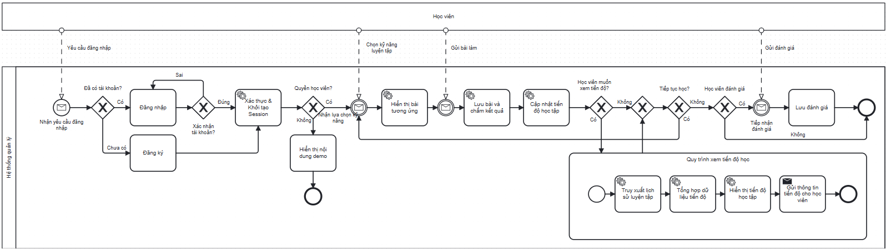

Hình 1. Sơ đồ quy trình nghiệp vụ (BPMN)

**Mô tả quy trình nghiệp vụ**

Quy trình nghiệp vụ của hệ thống bắt đầu khi người dùng gửi yêu cầu đăng nhập. Hệ thống tiếp nhận yêu cầu và kiểm tra người dùng đã có tài khoản hay chưa. Nếu đã có tài khoản, người dùng tiến hành đăng nhập và hệ thống kiểm tra tính hợp lệ của thông tin. Trường hợp thông tin không chính xác, người dùng được yêu cầu đăng nhập lại. Nếu chưa có tài khoản, người dùng thực hiện đăng ký. Theo sơ đồ hiện tại, sau bước đăng ký hoặc xác nhận thông tin đăng nhập hợp lệ, hệ thống tiến hành xác thực và khởi tạo phiên làm việc (Session).

Sau khi xác thực thành công, hệ thống kiểm tra quyền Học viên của tài khoản. Nếu tài khoản đã được cấp quyền Học viên, người dùng có thể truy cập các chức năng luyện tập. Ngược lại, hệ thống chuyển đến bước hiển thị nội dung Demo và kết thúc quy trình tại nhánh này.

Đối với tài khoản có quyền Học viên, quy trình luyện tập được thực hiện như sau:

Lựa chọn kỹ năng luyện tập: Học viên lựa chọn kỹ năng muốn luyện tập. Hệ thống tiếp nhận yêu cầu và hiển thị bài luyện tương ứng để học viên thực hiện.

Nộp bài và chấm kết quả: Sau khi hoàn thành bài luyện, học viên gửi bài làm đến hệ thống. Hệ thống tiếp nhận, lưu bài làm và thực hiện chấm kết quả theo chức năng của từng kỹ năng. Kết quả được ghi nhận để phục vụ việc theo dõi quá trình học tập.

Cập nhật và xem tiến độ học tập: Hệ thống cập nhật dữ liệu tiến độ sau khi ghi nhận bài luyện. Nếu học viên có nhu cầu xem tiến độ, hệ thống thực hiện quy trình xem tiến độ học tập, bao gồm truy xuất lịch sử luyện tập, tổng hợp dữ liệu, hiển thị thông tin tiến độ và gửi kết quả cho học viên. Sau khi hoàn tất, quy trình quay trở lại luồng chính. Nếu học viên không có nhu cầu xem tiến độ, hệ thống bỏ qua quy trình này.

Tiếp tục luyện tập: Hệ thống xác định học viên có muốn tiếp tục luyện tập hay không. Nếu có, học viên quay lại bước lựa chọn kỹ năng để thực hiện lượt luyện mới. Nếu không, quy trình chuyển sang bước đánh giá.

Đánh giá chất lượng dịch vụ: Học viên có thể lựa chọn gửi đánh giá hoặc góp ý về quá trình sử dụng hệ thống. Nếu có, hệ thống tiếp nhận và lưu thông tin đánh giá. Trường hợp học viên không muốn đánh giá, quy trình kết thúc mà không phát sinh dữ liệu đánh giá.

## C. Đặc tả Reading (UC-REA-01 đến UC-REA-06)

### b. Use case luyện tập Reading

**Sơ đồ use case luyện tập Reading**

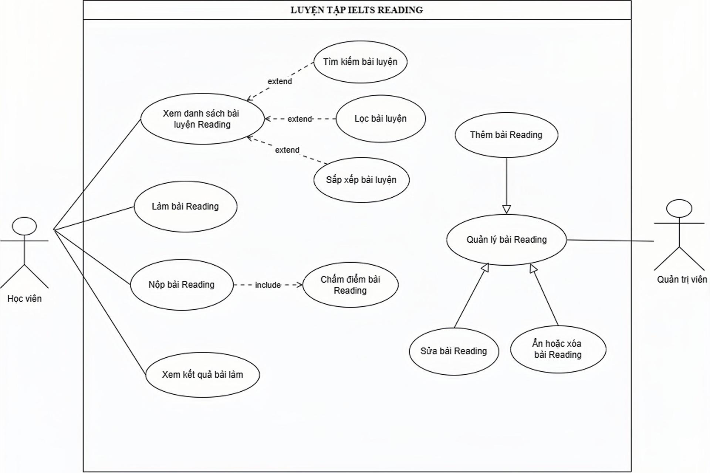

Hình 13. Sơ đồ use case luyện tập Reading

**Đặc tả use case xem danh sách bài luyện Reading**

| Use case name | Xem danh sách bài luyện Reading | ID UC-REA-01 |
| --- | --- | --- |
| Description | Học viên xem danh sách bài IELTS Reading đang hiển thị, gồm tên bài, chủ đề, trình độ và dạng câu hỏi (nếu có), từ danh sách có thể mở Tìm kiếm (UC-REA-02), Lọc (UC-REA-03) hoặc Sắp xếp (UC-REA-04) để chọn bài luyện. | Học viên xem danh sách bài IELTS Reading đang hiển thị, gồm tên bài, chủ đề, trình độ và dạng câu hỏi (nếu có), từ danh sách có thể mở Tìm kiếm (UC-REA-02), Lọc (UC-REA-03) hoặc Sắp xếp (UC-REA-04) để chọn bài luyện. |
| Actor | Học viên | Priority: Cao |
| Trigger | Học viên chọn kỹ năng Reading tại giao diện Luyện tập các kỹ năng IELTS. | Học viên chọn kỹ năng Reading tại giao diện Luyện tập các kỹ năng IELTS. |
| Pre-Conditions | Tài khoản đang hoạt động. Học viên đã đăng nhập bằng tài khoản có mã/email đăng nhập riêng. Tài khoản thuộc Group HOC_VIEN và đã được cấp quyền Học viên và được quyền sử dụng chức năng luyện tập Reading. | Tài khoản đang hoạt động. Học viên đã đăng nhập bằng tài khoản có mã/email đăng nhập riêng. Tài khoản thuộc Group HOC_VIEN và đã được cấp quyền Học viên và được quyền sử dụng chức năng luyện tập Reading. |
| Post-Conditions | Danh sách các bài luyện Reading đang khả dụng được hiển thị. Không làm thay đổi dữ liệu hệ thống. | Danh sách các bài luyện Reading đang khả dụng được hiển thị. Không làm thay đổi dữ liệu hệ thống. |
| Basic Flow | Học viên | Hệ thống |
| Basic Flow | 1. Chọn chức năng Luyện tập Reading | 2. Xác thực tài khoản đăng nhập và kiểm tra quyền Học viên qua Group HOC_VIEN. |
| Basic Flow |  | 3. Kiểm tra và truy xuất các bài Reading đang được phép hiển thị. |
| Basic Flow |  | 4. Hiển thị danh sách bài luyện Reading. |
| Basic Flow | 5. Xem danh sách và chọn bài Reading muốn luyện tập. | 6. Điều hướng đến giao diện làm bài của bài đã chọn. |
| Alternative Flow | A1 - Tìm kiếm bài luyện: Học viên chọn chức năng tìm kiếm → nhập từ khóa → hệ thống hiển thị các bài Reading phù hợp. A2 - Lọc bài luyện: Học viên chọn điều kiện lọc → hệ thống hiển thị các bài Reading phù hợp với điều kiện đã chọn. A3 - Sắp xếp bài luyện: Học viên chọn tiêu chí sắp xếp → hệ thống sắp xếp và hiển thị danh sách tương ứng. | A1 - Tìm kiếm bài luyện: Học viên chọn chức năng tìm kiếm → nhập từ khóa → hệ thống hiển thị các bài Reading phù hợp. A2 - Lọc bài luyện: Học viên chọn điều kiện lọc → hệ thống hiển thị các bài Reading phù hợp với điều kiện đã chọn. A3 - Sắp xếp bài luyện: Học viên chọn tiêu chí sắp xếp → hệ thống sắp xếp và hiển thị danh sách tương ứng. |
| Exception Flow | E1 - Người dùng chưa đăng nhập, tài khoản bị khóa hoặc chưa được cấp quyền Học viên: Hệ thống từ chối chức năng dành cho Học viên và được thông báo chờ cấp quyền Học viên. E2 - Không có bài Reading khả dụng: Hệ thống hiển thị thông báo “Hiện chưa có bài luyện Reading.” E3 - Không thể truy xuất dữ liệu: Hệ thống hiển thị thông báo lỗi và cho phép Học viên thử lại. | E1 - Người dùng chưa đăng nhập, tài khoản bị khóa hoặc chưa được cấp quyền Học viên: Hệ thống từ chối chức năng dành cho Học viên và được thông báo chờ cấp quyền Học viên. E2 - Không có bài Reading khả dụng: Hệ thống hiển thị thông báo “Hiện chưa có bài luyện Reading.” E3 - Không thể truy xuất dữ liệu: Hệ thống hiển thị thông báo lỗi và cho phép Học viên thử lại. |

Bảng 10. Đặc tả use case Xem danh sách bài luyện Reading

**Thiết kế giao diện:**

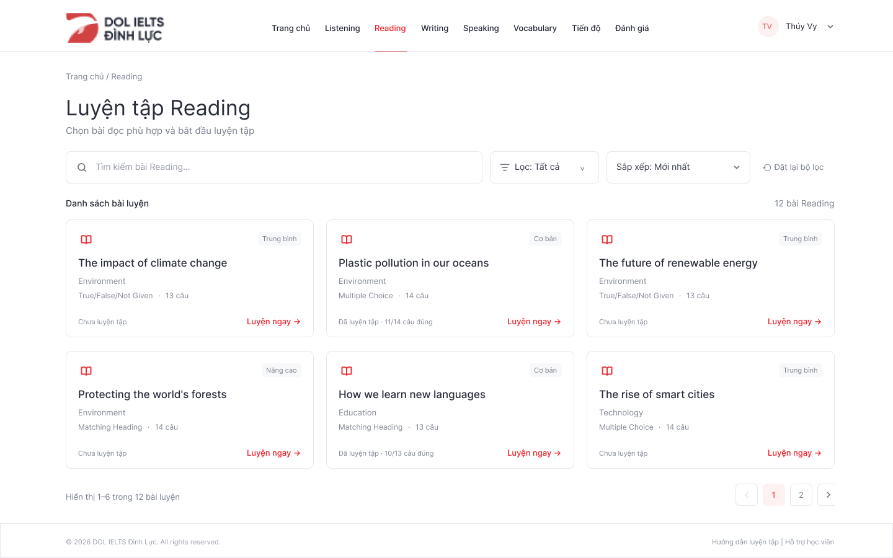

Hình 14. Danh sách luyện tập tổng quát

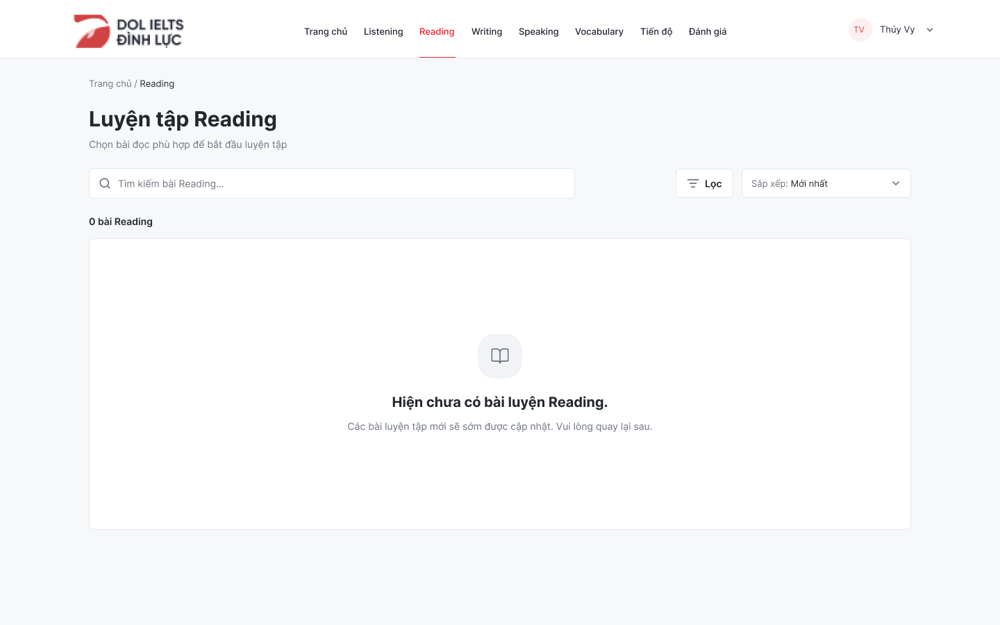

Hình 15. Danh sách trống

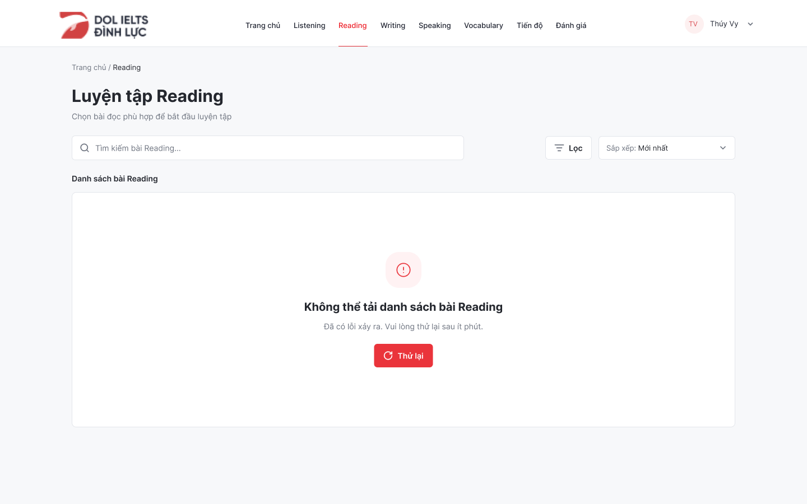

Hình 16. Không thể truy xuất dữ liệu

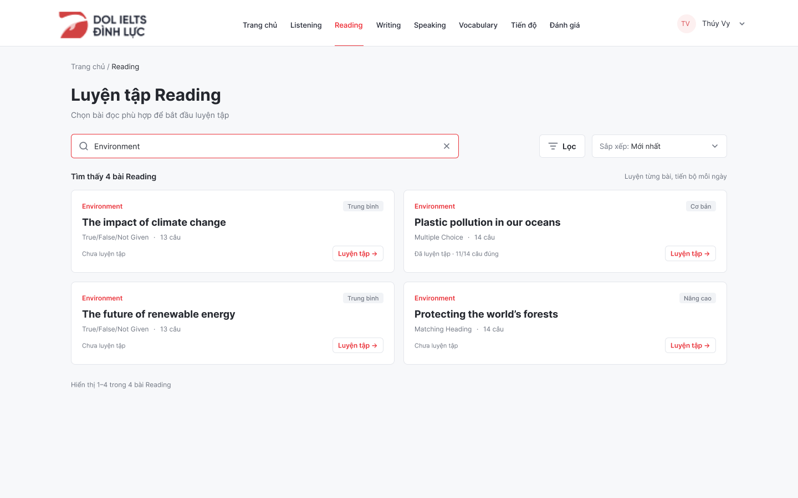

Hình 17. Tìm kiếm bài luyện

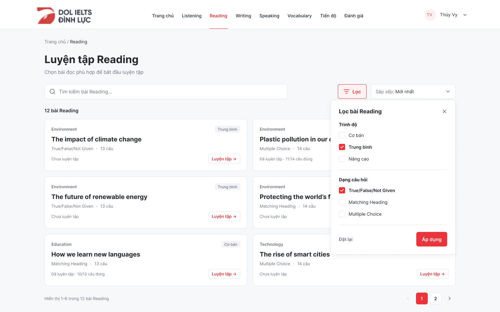

Hình 18. Lọc & Sắp xếp bài Reading

**Đặc tả use case làm bài Reading**

| Use case name | Làm bài Reading | ID UC-REA-02 |
| --- | --- | --- |
| Description | Học viên thực hiện một bài luyện IELTS Reading bằng cách đọc passage và trả lời các câu hỏi đi kèm. | Học viên thực hiện một bài luyện IELTS Reading bằng cách đọc passage và trả lời các câu hỏi đi kèm. |
| Actor | Học viên | Priority: Cao |
| Trigger | Học viên chọn một bài Reading từ danh sách bài luyện. | Học viên chọn một bài Reading từ danh sách bài luyện. |
| Pre-Conditions | Tài khoản đang hoạt động. Học viên đã đăng nhập bằng tài khoản có mã/email đăng nhập riêng. Tài khoản thuộc Group HOC_VIEN và đã được cấp quyền Học viên và được quyền sử dụng chức năng luyện tập Reading. Bài Reading tồn tại và đang ở trạng thái được phép hiển thị. | Tài khoản đang hoạt động. Học viên đã đăng nhập bằng tài khoản có mã/email đăng nhập riêng. Tài khoản thuộc Group HOC_VIEN và đã được cấp quyền Học viên và được quyền sử dụng chức năng luyện tập Reading. Bài Reading tồn tại và đang ở trạng thái được phép hiển thị. |
| Post-Conditions | Passage và câu hỏi được hiển thị, câu trả lời hiện tại chỉ giữ trên giao diện trong khi làm bài, chưa ghi lịch sử nếu chưa nộp thành công. | Passage và câu hỏi được hiển thị, câu trả lời hiện tại chỉ giữ trên giao diện trong khi làm bài, chưa ghi lịch sử nếu chưa nộp thành công. |
| Basic Flow | Học viên | Hệ thống |
| Basic Flow | 1. Chọn một bài Reading. | 2. Kiểm tra quyền truy cập của Học viên. |
| Basic Flow |  | 3. Truy xuất và hiển thị passage cùng các câu hỏi tương ứng. |
| Basic Flow | 4. Đọc passage, nhập hoặc chọn câu trả lời. | 5. Giao diện ghi nhận câu trả lời tạm thời, không chấm hay tạo lượt luyện trước khi nộp. |
| Basic Flow | 6. Kiểm tra và chỉnh sửa câu trả lời. | 7. Hiển thị câu trả lời đã chọn để học viên tiếp tục chỉnh sửa. |
| Basic Flow | 8. Chọn Nộp bài khi muốn gửi bài làm, kể cả khi còn câu chưa trả lời. | 9. Chuyển sang quy trình nộp và chấm bài. |
| Alternative Flow | A1 - Thay đổi câu trả lời: Học viên quay lại câu hỏi đã làm → thay đổi đáp án → hệ thống cập nhật câu trả lời. A2 - Chưa hoàn thành: Học viên tiếp tục làm các câu hỏi còn lại → hệ thống duy trì các câu trả lời hiện tại. A3 - Rời bài trước khi nộp: Học viên chọn rời khỏi bài khi chưa nộp → hệ thống cảnh báo việc bài làm chưa được lưu.  Chọn Ở lại → tiếp tục làm bài và giữ nguyên nội dung hiện tại.  Chọn Rời khỏi → kết thúc phiên làm bài; bài chưa nộp không được ghi nhận vào lịch sử luyện tập. | A1 - Thay đổi câu trả lời: Học viên quay lại câu hỏi đã làm → thay đổi đáp án → hệ thống cập nhật câu trả lời. A2 - Chưa hoàn thành: Học viên tiếp tục làm các câu hỏi còn lại → hệ thống duy trì các câu trả lời hiện tại. A3 - Rời bài trước khi nộp: Học viên chọn rời khỏi bài khi chưa nộp → hệ thống cảnh báo việc bài làm chưa được lưu.  Chọn Ở lại → tiếp tục làm bài và giữ nguyên nội dung hiện tại.  Chọn Rời khỏi → kết thúc phiên làm bài; bài chưa nộp không được ghi nhận vào lịch sử luyện tập. |
| Exception Flow | E1 - Người dùng chưa đăng nhập, tài khoản bị khóa hoặc chưa được cấp quyền Học viên: Hệ thống từ chối chức năng dành cho Học viênvà được thông báo chờ cấp quyền Học viên. E2 - Bài Reading không tồn tại hoặc đã bị ẩn: Hệ thống thông báo bài luyện không còn khả dụng và đưa Học viên về danh sách bài Reading. E3 - Không thể tải nội dung bài: Hệ thống thông báo lỗi và cho phép Học viên thử lại. | E1 - Người dùng chưa đăng nhập, tài khoản bị khóa hoặc chưa được cấp quyền Học viên: Hệ thống từ chối chức năng dành cho Học viênvà được thông báo chờ cấp quyền Học viên. E2 - Bài Reading không tồn tại hoặc đã bị ẩn: Hệ thống thông báo bài luyện không còn khả dụng và đưa Học viên về danh sách bài Reading. E3 - Không thể tải nội dung bài: Hệ thống thông báo lỗi và cho phép Học viên thử lại. |

Bảng 11. Đặc tả use case Làm bài Reading

**Thiết kế giao diện:**

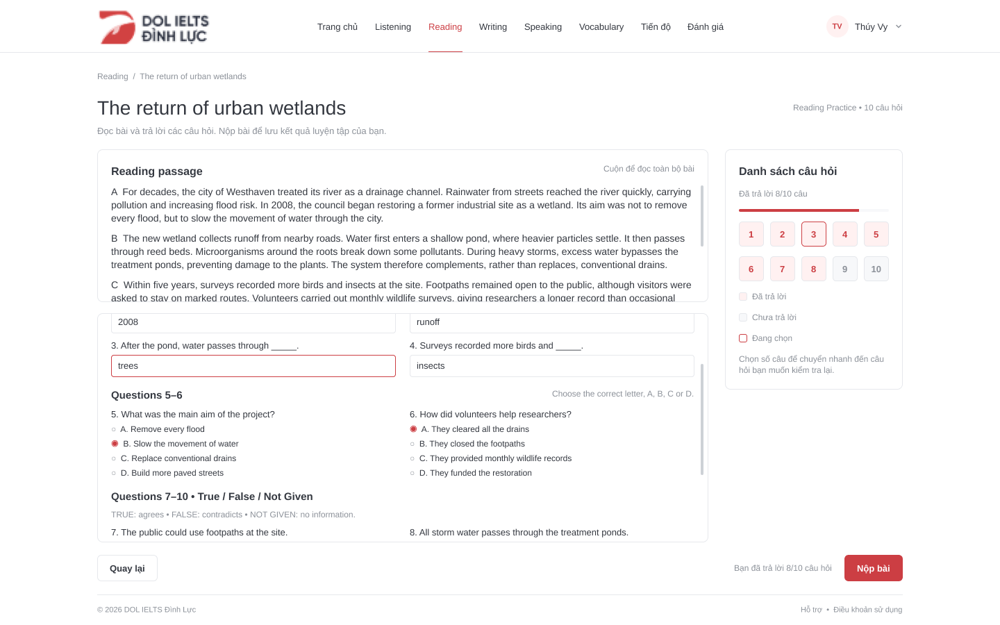

Hình 19. Làm bài Reading

**Đặc tả use case nộp bài Reading**

| Use case name | Nộp bài Reading | ID UC-REA-03 |
| --- | --- | --- |
| Description | Học viên gửi bài Reading đã thực hiện. Hệ thống kiểm tra, lưu bài làm và kích hoạt chức năng chấm điểm. | Học viên gửi bài Reading đã thực hiện. Hệ thống kiểm tra, lưu bài làm và kích hoạt chức năng chấm điểm. |
| Actor | Học viên | Priority: Cao |
| Trigger | Học viên nhấn Nộp bài trên giao diện làm bài Reading. | Học viên nhấn Nộp bài trên giao diện làm bài Reading. |
| Pre-Conditions | Tài khoản đang hoạt động. Học viên đã đăng nhập bằng tài khoản có mã/email đăng nhập riêng. Tài khoản thuộc Group HOC_VIEN và đã được cấp quyền Học viên và được quyền sử dụng chức năng luyện tập Reading. Học viên đang thực hiện một bài Reading hợp lệ. | Tài khoản đang hoạt động. Học viên đã đăng nhập bằng tài khoản có mã/email đăng nhập riêng. Tài khoản thuộc Group HOC_VIEN và đã được cấp quyền Học viên và được quyền sử dụng chức năng luyện tập Reading. Học viên đang thực hiện một bài Reading hợp lệ. |
| Post-Conditions | Chỉ sau khi xác nhận và xử lý nộp thành công, hệ thống ghi một lượt luyện mới, câu trả lời, đáp án tại thời điểm nộp, thời gian và kết quả chấm theo tài khoản; giữ nguyên các lượt cũ. Gửi lặp cùng yêu cầu không tạo lượt bổ sung; chọn luyện lại chủ động mới tạo lượt mới. | Chỉ sau khi xác nhận và xử lý nộp thành công, hệ thống ghi một lượt luyện mới, câu trả lời, đáp án tại thời điểm nộp, thời gian và kết quả chấm theo tài khoản; giữ nguyên các lượt cũ. Gửi lặp cùng yêu cầu không tạo lượt bổ sung; chọn luyện lại chủ động mới tạo lượt mới. |
| Basic Flow | Học viên | Hệ thống |
| Basic Flow | 1. Học viên thực hiện bài Reading; có thể còn câu bỏ trống. |  |
| Basic Flow | 2. Nhấn “Nộp bài”. | 3. Kiểm tra các câu còn trống; hiển thị thông báo xác nhận nộp, cho phép quay lại làm tiếp hoặc vẫn nộp. |
| Basic Flow | 4. Xác nhận nộp bài. | 5. Kiểm tra lại Session, HOC_VIEN, bài đang hiển thị và dữ liệu câu trả lời; câu bỏ trống được chấp nhận. |
| Basic Flow |  | 6. Kích hoạt UC-REA-07 để chấm từ đáp án hệ thống, không gửi đáp án chuẩn về trình duyệt trước khi nộp. |
| Basic Flow |  | 7. Lưu một lượt luyện kèm đáp án và kết quả ở thời điểm nộp; chỉ sau khi lưu thành công mới thông báo kết quả và cho xem UC-REA-08. |
| Alternative Flow | A1 - Hủy hoặc quay lại làm tiếp: Học viên không xác nhận nộp → giữ nguyên bài trên giao diện, chưa lưu lịch sử. A2 - Còn câu chưa trả lời: Hiển thị cảnh báo; học viên quay lại làm tiếp hoặc xác nhận vẫn nộp. Câu bỏ trống không tính là đúng. A3 - Bỏ trống toàn bộ: Vẫn cho phép xác nhận nộp sau cảnh báo, kết quả 0 câu đúng nếu chấm và lưu thành công. A4 - Chủ động chọn luyện lại sau khi đã nộp: Tạo lượt luyện mới, không ghi đè lượt trước. | A1 - Hủy hoặc quay lại làm tiếp: Học viên không xác nhận nộp → giữ nguyên bài trên giao diện, chưa lưu lịch sử. A2 - Còn câu chưa trả lời: Hiển thị cảnh báo; học viên quay lại làm tiếp hoặc xác nhận vẫn nộp. Câu bỏ trống không tính là đúng. A3 - Bỏ trống toàn bộ: Vẫn cho phép xác nhận nộp sau cảnh báo, kết quả 0 câu đúng nếu chấm và lưu thành công. A4 - Chủ động chọn luyện lại sau khi đã nộp: Tạo lượt luyện mới, không ghi đè lượt trước. |
| Exception Flow | E1 - Phiên đăng nhập hết hạn, tài khoản bị khóa, không còn HOC_VIEN hoặc bài bị ẩn: Từ chối nộp; không tạo lượt luyện. E2 - Dữ liệu nộp không hợp lệ (không thuộc bài, sai cấu trúc): Báo lỗi, không coi câu trả lời bỏ trống là dữ liệu không hợp lệ. E3 - Không thể chấm hoặc lưu: Báo lỗi, không ghi nhận lượt luyện chưa hoàn tất, không thông báo thành công. E4 - Gửi trùng cùng yêu cầu nộp đã thành công: Không tạo lượt luyện hoặc kết quả trùng. | E1 - Phiên đăng nhập hết hạn, tài khoản bị khóa, không còn HOC_VIEN hoặc bài bị ẩn: Từ chối nộp; không tạo lượt luyện. E2 - Dữ liệu nộp không hợp lệ (không thuộc bài, sai cấu trúc): Báo lỗi, không coi câu trả lời bỏ trống là dữ liệu không hợp lệ. E3 - Không thể chấm hoặc lưu: Báo lỗi, không ghi nhận lượt luyện chưa hoàn tất, không thông báo thành công. E4 - Gửi trùng cùng yêu cầu nộp đã thành công: Không tạo lượt luyện hoặc kết quả trùng. |

Bảng 12. Đặc tả use case Nộp bài Reading

**Thiết kế giao diện:**

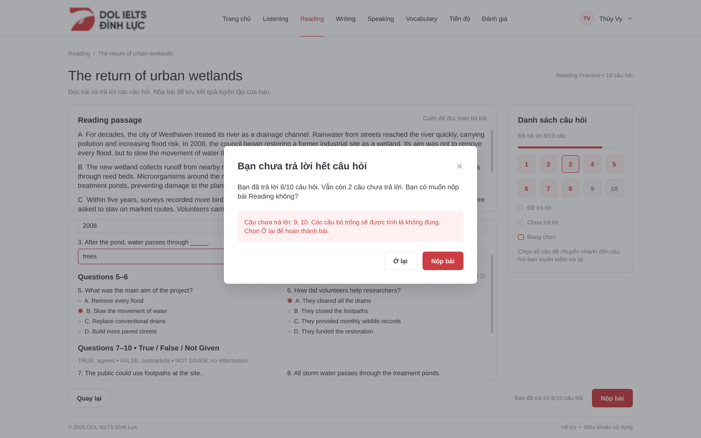

Hình 20. Giao diện nộp bài Reading

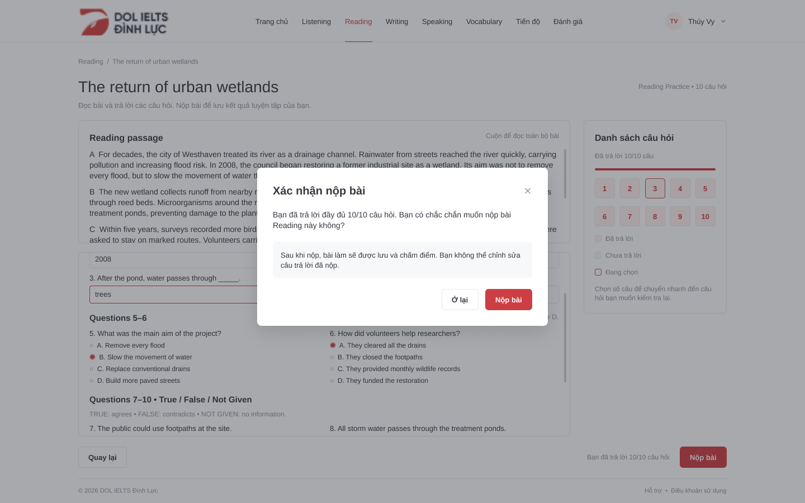

Hình 21. Xác nhận nộp bài

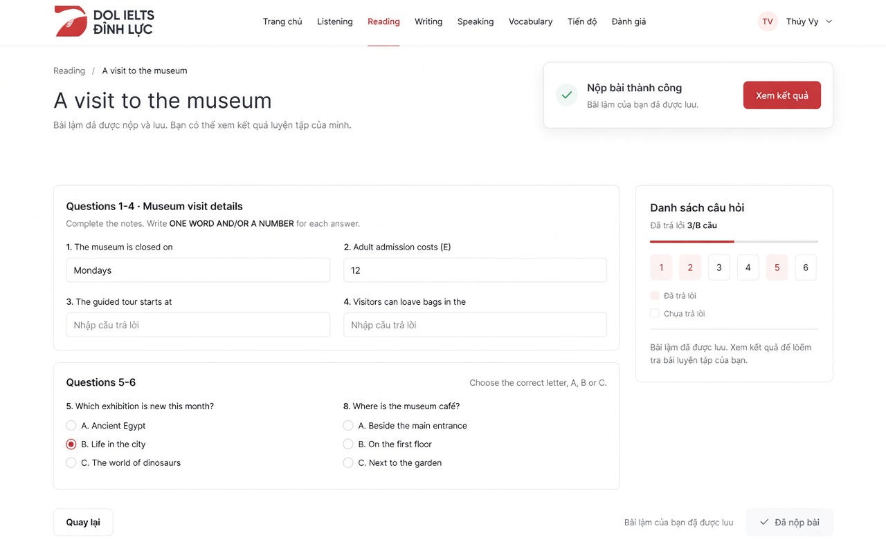

Hình 22. Nộp bài thành công

**Đặc tả use case chấm điểm bài Reading**

| Use case name | Chấm điểm bài Reading | ID UC-REA-04 |
| --- | --- | --- |
| Description | Hệ thống đối chiếu câu trả lời đã nộp với bộ đáp án của bài Reading, chấm theo từng câu và trả kết quả cho UC-REA-06. Không tạo thêm lượt luyện riêng. | Hệ thống đối chiếu câu trả lời đã nộp với bộ đáp án của bài Reading, chấm theo từng câu và trả kết quả cho UC-REA-06. Không tạo thêm lượt luyện riêng. |
| Actor | Học viên | Priority: Cao |
| Trigger | Được hệ thống kích hoạt tự động từ Use Case Nộp bài Reading | Được hệ thống kích hoạt tự động từ Use Case Nộp bài Reading |
| Pre-Conditions | Nhận được dữ liệu các câu trả lời do học viên gửi từ Use Case Nộp bài Reading. Yêu cầu nộp bài đã được kiểm tra: tài khoản đang hoạt động, đã đăng nhập và thuộc Group HOC_VIEN; câu trả lời thuộc đúng bài đang nộp. | Nhận được dữ liệu các câu trả lời do học viên gửi từ Use Case Nộp bài Reading. Yêu cầu nộp bài đã được kiểm tra: tài khoản đang hoạt động, đã đăng nhập và thuộc Group HOC_VIEN; câu trả lời thuộc đúng bài đang nộp. |
| Post-Conditions | Kết quả chấm Reading được trả về UC-REA-06 để lưu khi nộp thành công; câu bỏ trống không được tính đúng, bỏ trống toàn bộ cho kết quả 0 câu đúng. | Kết quả chấm Reading được trả về UC-REA-06 để lưu khi nộp thành công; câu bỏ trống không được tính đúng, bỏ trống toàn bộ cho kết quả 0 câu đúng. |
| Basic Flow | Học viên | Hệ thống |
| Basic Flow | 1. Xác nhận nộp bài Reading. | 2. Nhận dữ liệu câu trả lời hợp lệ từ Use Case Nộp bài Reading. |
| Basic Flow |  | 3. Truy xuất bộ đáp án chuẩn (Answer Key) của bài Reading từ CSDL. |
| Basic Flow |  | 4. So khớp từng câu trả lời của học viên với đáp án chuẩn |
| Basic Flow |  | 5. Tính điểm bài Reading; câu bỏ trống không đúng và bỏ trống toàn bộ được 0 câu đúng. |
| Basic Flow |  | 6. Trả số câu đúng, tổng số câu, điểm và kết quả từng câu về Use Case Nộp bài Reading. |
| Exception Flow | E1 - Không có đáp án: Hệ thống không thể chấm bài và thông báo lỗi. E2 - Không thể xử lý bài làm: Hệ thống thông báo không thể chấm điểm và yêu cầu thực hiện lại sau. E3 - Nếu lưu dữ liệu trong quy trình nộp bài thất bại: Hệ thống không ghi nhận lượt luyện hoàn tất và không hiển thị thông báo nộp thành công. | E1 - Không có đáp án: Hệ thống không thể chấm bài và thông báo lỗi. E2 - Không thể xử lý bài làm: Hệ thống thông báo không thể chấm điểm và yêu cầu thực hiện lại sau. E3 - Nếu lưu dữ liệu trong quy trình nộp bài thất bại: Hệ thống không ghi nhận lượt luyện hoàn tất và không hiển thị thông báo nộp thành công. |

Bảng 13. Đặc tả use case Chấm điểm bài Reading

**Thiết kế giao diện:**

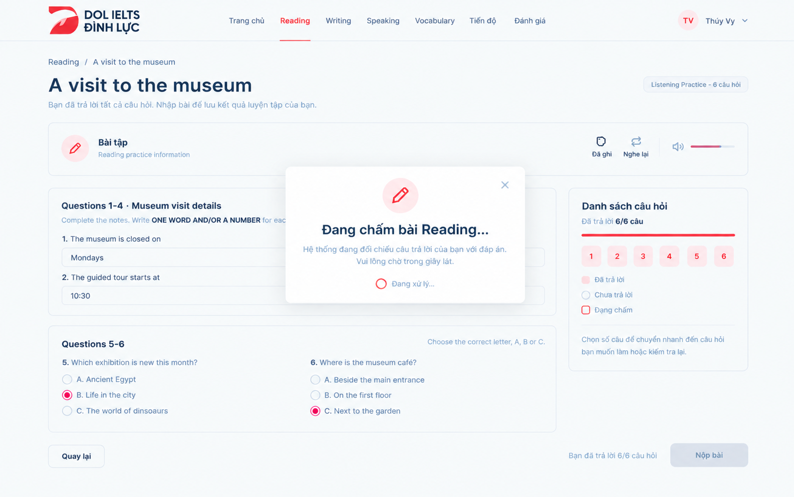

Hình 23. Chấm bài Reading

**Đặc tả use case xem kết quả bài làm Reading**

| Use case name | Xem kết quả bài làm | ID UC-REA-05 |
| --- | --- | --- |
| Description | Học viên xem kết quả của một lượt Reading đã nộp thành công, gồm số câu đúng, tổng số câu, tỷ lệ đúng và chi tiết câu trả lời/đáp án đã lưu của chính lượt đó. Tổng hợp qua nhiều lượt thuộc Progress. | Học viên xem kết quả của một lượt Reading đã nộp thành công, gồm số câu đúng, tổng số câu, tỷ lệ đúng và chi tiết câu trả lời/đáp án đã lưu của chính lượt đó. Tổng hợp qua nhiều lượt thuộc Progress. |
| Actor | Học viên | Priority: Cao |
| Trigger | Học viên chọn Xem kết quả bài làm sau khi hoàn thành bài Reading. | Học viên chọn Xem kết quả bài làm sau khi hoàn thành bài Reading. |
| Pre-Conditions | Tài khoản đang hoạt động. Học viên đã đăng nhập bằng tài khoản có mã/email đăng nhập riêng. Tài khoản thuộc Group HOC_VIEN và đã được cấp quyền Học viên và được quyền sử dụng chức năng luyện tập Reading.  Học viên đã có ít nhất một bài Reading được chấm điểm. | Tài khoản đang hoạt động. Học viên đã đăng nhập bằng tài khoản có mã/email đăng nhập riêng. Tài khoản thuộc Group HOC_VIEN và đã được cấp quyền Học viên và được quyền sử dụng chức năng luyện tập Reading.  Học viên đã có ít nhất một bài Reading được chấm điểm. |
| Post-Conditions | Kết quả bài Reading được hiển thị. Không làm thay đổi kết quả đã lưu. | Kết quả bài Reading được hiển thị. Không làm thay đổi kết quả đã lưu. |
| Basic Flow | Học viên | Hệ thống |
| Basic Flow | 1. Chọn Xem kết quả bài làm. | 2. Xác định tài khoản Học viên. |
| Basic Flow |  | 3. Xác định lượt luyện Reading tương ứng. |
| Basic Flow |  | 4. Hiển thị số câu đúng/tổng câu, tỷ lệ đúng và thời gian nộp; không hiển thị thống kê nhiều lần luyện tại đây. |
| Basic Flow | 5. Xem điểm và kết quả bài làm. |  |
| Basic Flow | 6. Chọn xem chi tiết đáp án | 7. Hiển thị câu hỏi, câu trả lời của học viên và đáp án tương ứng. |
| Alternative Flow | A1 - Chọn bài khác: Học viên chọn một bài Reading khác đã hoàn thành → hệ thống hiển thị kết quả tương ứng. | A1 - Chọn bài khác: Học viên chọn một bài Reading khác đã hoàn thành → hệ thống hiển thị kết quả tương ứng. |
| Exception Flow | E1 - Người dùng chưa đăng nhập, tài khoản bị khóa hoặc chưa được cấp quyền Học viên: Hệ thống từ chối chức năng dành cho Học viênvà được thông báo chờ cấp quyền Học viên. E2 - Chưa có kết quả: Hệ thống hiển thị “Chưa có kết quả bài làm.” E3 - Không thể truy xuất kết quả: Hệ thống thông báo lỗi và cho phép Học viên thử lại. | E1 - Người dùng chưa đăng nhập, tài khoản bị khóa hoặc chưa được cấp quyền Học viên: Hệ thống từ chối chức năng dành cho Học viênvà được thông báo chờ cấp quyền Học viên. E2 - Chưa có kết quả: Hệ thống hiển thị “Chưa có kết quả bài làm.” E3 - Không thể truy xuất kết quả: Hệ thống thông báo lỗi và cho phép Học viên thử lại. |

Bảng 14. Đặc tả use case Xem kết quả bài làm

**Thiết kế giao diện:**

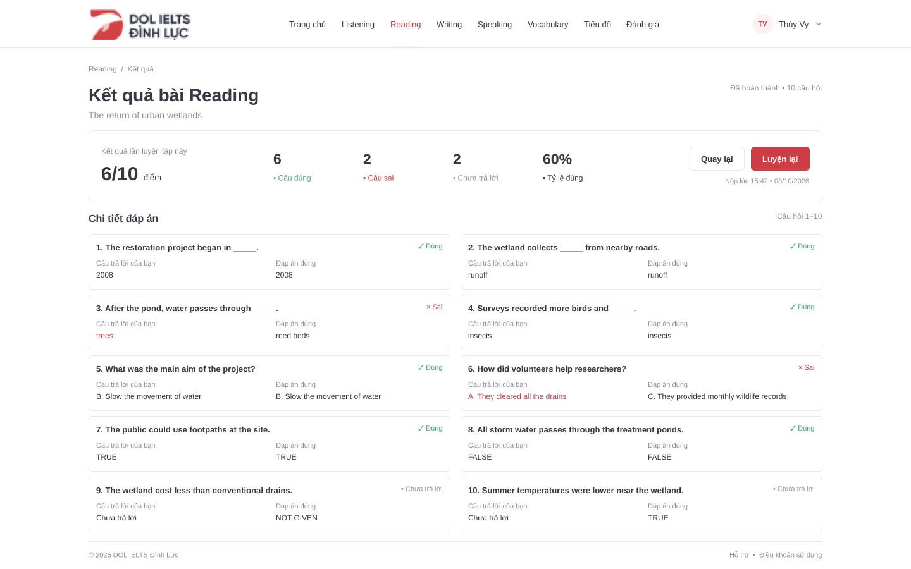

Hình 24. Xem kết quả bài Reading

**Đặc tả use case quản lý bài Reading**

| Use case name | Quản lý bài Reading | ID UC-REA-06 |
| --- | --- | --- |
| Description | Quản trị viên quản lý các bài Reading trên hệ thống, bao gồm thêm, sửa và ẩn hoặc xóa bài Reading. | Quản trị viên quản lý các bài Reading trên hệ thống, bao gồm thêm, sửa và ẩn hoặc xóa bài Reading. |
| Actor | Quản trị viên | Priority: Cao |
| Trigger | Quản trị viên chọn chức năng Quản lý bài Reading. | Quản trị viên chọn chức năng Quản lý bài Reading. |
| Pre-Conditions | Quản trị viên đã đăng nhập vào hệ thống. Quản trị viên có quyền quản lý bài Reading. | Quản trị viên đã đăng nhập vào hệ thống. Quản trị viên có quyền quản lý bài Reading. |
| Post-Conditions | Thông tin hoặc trạng thái bài Reading được cập nhật theo thao tác của Quản trị viên. | Thông tin hoặc trạng thái bài Reading được cập nhật theo thao tác của Quản trị viên. |
| Basic Flow | Quản trị viên | Hệ thống |
| Basic Flow | 1. Chọn Quản lý bài Reading. | 2. Xác thực quyền của Quản trị viên. |
| Basic Flow | 3. Chọn bài và thao tác cần thực hiện. | 4. Hiển thị thông tin, biểu mẫu hoặc yêu cầu xác nhận tương ứng. |
| Basic Flow | 5. Nhập dữ liệu hoặc xác nhận thao tác. | 6. Kiểm tra quyền và tính hợp lệ của dữ liệu/thao tác, lưu thay đổi nếu hợp lệ và cập nhật danh sách. |
| Basic Flow | 7. Xem thông báo và danh sách đã cập nhật. |  |
| Alternative Flow | A1 - Thêm bài Reading: Quản trị viên chọn thêm bài → nhập thông tin và nội dung → hệ thống kiểm tra → lưu bài. A2 - Sửa bài Reading: Quản trị viên chọn bài cần sửa → cập nhật thông tin → Hệ thống lưu thay đổi. A3 - Ẩn hoặc xóa bài Reading: Quản trị viên chọn bài → chọn ẩn hoặc xóa → Hệ thống cập nhật trạng thái/xóa dữ liệu theo thao tác. A4 - Hiện lại đề Reading: Quản trị viên chọn “Hiện” tại đề đang ẩn → Hệ thống cập nhật trạng thái → đề được phép xuất hiện trở lại cho học viên. | A1 - Thêm bài Reading: Quản trị viên chọn thêm bài → nhập thông tin và nội dung → hệ thống kiểm tra → lưu bài. A2 - Sửa bài Reading: Quản trị viên chọn bài cần sửa → cập nhật thông tin → Hệ thống lưu thay đổi. A3 - Ẩn hoặc xóa bài Reading: Quản trị viên chọn bài → chọn ẩn hoặc xóa → Hệ thống cập nhật trạng thái/xóa dữ liệu theo thao tác. A4 - Hiện lại đề Reading: Quản trị viên chọn “Hiện” tại đề đang ẩn → Hệ thống cập nhật trạng thái → đề được phép xuất hiện trở lại cho học viên. |
| Exception Flow | E1 - Quản trị viên không có quyền: Hệ thống từ chối thao tác và thông báo không đủ quyền. E2 - Dữ liệu bài Reading không hợp lệ: Hệ thống thông báo lỗi và yêu cầu Quản trị viên kiểm tra lại. E3 - Không thể cập nhật dữ liệu: Hệ thống thông báo lỗi và yêu cầu thử lại. Nếu bài/câu hỏi hoặc từ vựng đã phát sinh lịch sử, hệ thống không xóa vật lý. Quản trị viên dùng Ẩn để giữ liên kết và dữ liệu kết quả cũ. Khi sửa nội dung đã dùng, kết quả và đáp án của các lần luyện trước vẫn giữ nguyên. | E1 - Quản trị viên không có quyền: Hệ thống từ chối thao tác và thông báo không đủ quyền. E2 - Dữ liệu bài Reading không hợp lệ: Hệ thống thông báo lỗi và yêu cầu Quản trị viên kiểm tra lại. E3 - Không thể cập nhật dữ liệu: Hệ thống thông báo lỗi và yêu cầu thử lại. Nếu bài/câu hỏi hoặc từ vựng đã phát sinh lịch sử, hệ thống không xóa vật lý. Quản trị viên dùng Ẩn để giữ liên kết và dữ liệu kết quả cũ. Khi sửa nội dung đã dùng, kết quả và đáp án của các lần luyện trước vẫn giữ nguyên. |

Bảng 15. Đặc tả use case Quản lý bài Reading

**Thiết kế giao diện:**

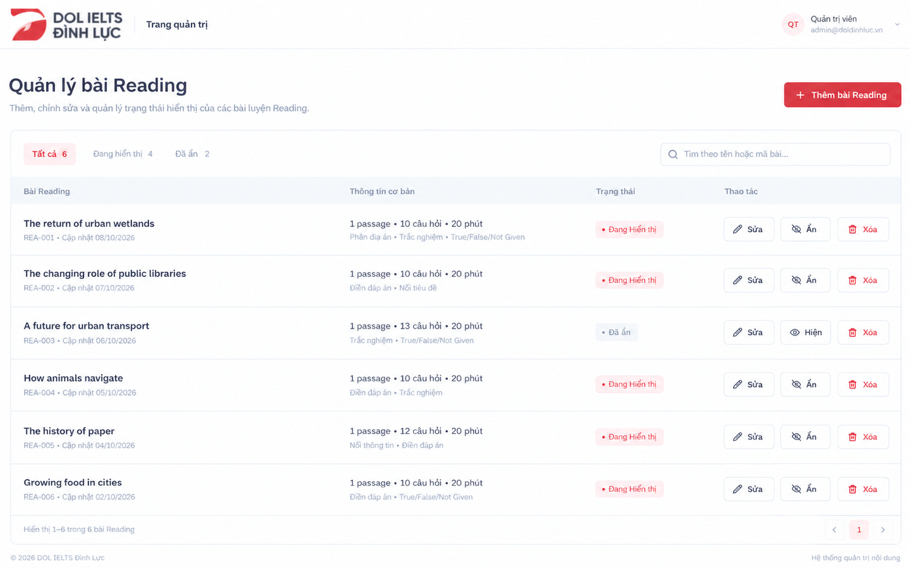

Hình 25. Danh sách quản lý bài Reading

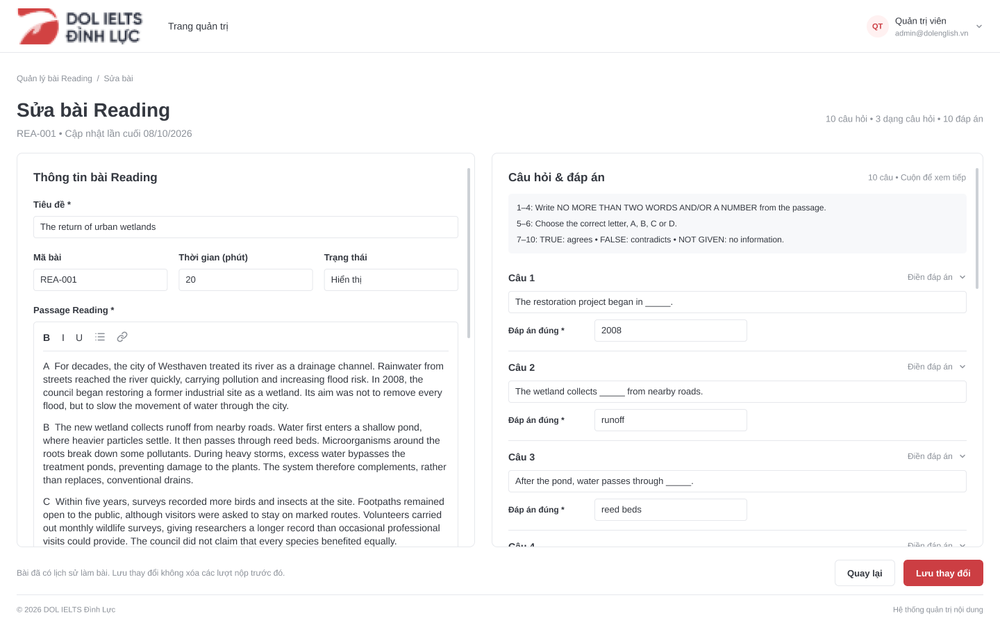

Hình 26. Sửa bài Reading

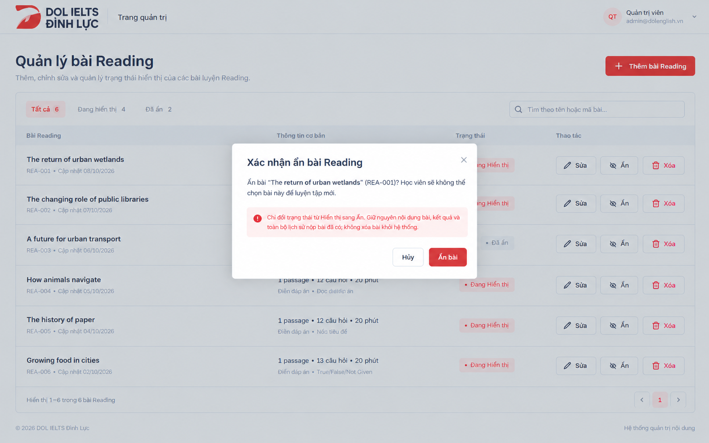

Hình 27. Ẩn bài Reading

## D. Đặc tả Listening (UC-LIS-01 đến UC-LIS-06)

### e. Use case luyện tập listening

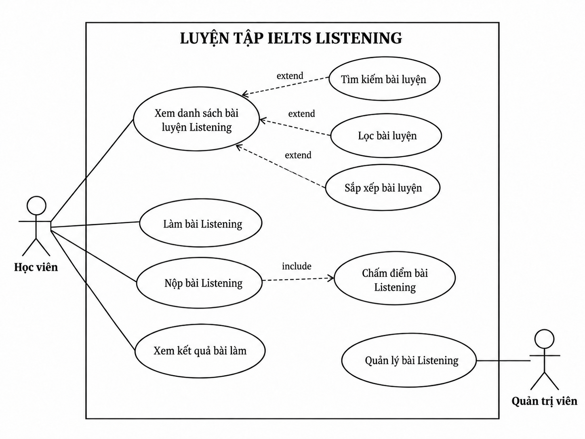

Hình 46. Sơ đồ use case luyện tập Listening

**Đặc tả use case Xem danh sách bài luyện listening**

| Use case name | Xem danh sách bài luyện Listening | UC-LIS-01 |
| --- | --- | --- |
| Description | Học viên truy cập danh sách các bài luyện IELTS Listening hiện có trong hệ thống để xem và lựa chọn bài muốn luyện tập. Học viên có thể sử dụng chức năng tìm kiếm, lọc hoặc sắp xếp danh sách khi cần. | Học viên truy cập danh sách các bài luyện IELTS Listening hiện có trong hệ thống để xem và lựa chọn bài muốn luyện tập. Học viên có thể sử dụng chức năng tìm kiếm, lọc hoặc sắp xếp danh sách khi cần. |
| Actor | Học viên | Priority: Cao |
| Trigger | Học viên truy cập chức năng luyện tập IELTS Listening | Học viên truy cập chức năng luyện tập IELTS Listening |
| Pre-Conditions | Tài khoản đang hoạt động. Học viên đã đăng nhập vào hệ thống. Tài khoản thuộc Group HOC_VIEN và đã được cấp quyền Học viên và được quyền sử dụng chức năng luyện tập Listening | Tài khoản đang hoạt động. Học viên đã đăng nhập vào hệ thống. Tài khoản thuộc Group HOC_VIEN và đã được cấp quyền Học viên và được quyền sử dụng chức năng luyện tập Listening |
| Post-Conditions | Danh sách các bài Listening đang khả dụng được hiển thị để học viên lựa chọn. Không làm thay đổi dữ liệu hệ thống | Danh sách các bài Listening đang khả dụng được hiển thị để học viên lựa chọn. Không làm thay đổi dữ liệu hệ thống |
| Basic Flow | Học viên | Hệ thống |
| Basic Flow | 1. Truy cập chức năng luyện tập Listening | 2. Xác định tài khoản học viên đang đăng nhập và kiểm tra quyền truy cập |
| Basic Flow |  | 3. Truy xuất các bài Listening đang ở trạng thái được phép hiển thị |
| Basic Flow |  | 4. Hiển thị danh sách các bài luyện Listening |
| Basic Flow | 5. Xem thông tin các bài luyện. |  |
|  | 6. Chọn một bài Listening muốn thực hiện | 7. Điều hướng đến chức năng “Làm bài Listening” |
| Alternative Flow | A1 - Tìm kiếm, lọc và sắp xếp bài luyện: Học viên nhập từ khóa, lựa chọn điều kiện lọc hoặc tiêu chí sắp xếp. Hệ thống truy xuất và hiển thị danh sách bài Listening phù hợp với các điều kiện được chọn. Học viên có thể thay đổi hoặc xóa điều kiện để cập nhật danh sách. A2 - Không có bài luyện phù hợp: Hệ thống không tìm thấy bài Listening đáp ứng điều kiện tìm kiếm hoặc lọc, hoặc hiện chưa có bài luyện khả dụng. Hệ thống hiển thị thông báo tương ứng và cho phép Học viên thay đổi điều kiện tìm kiếm hoặc quay lại danh sách. | A1 - Tìm kiếm, lọc và sắp xếp bài luyện: Học viên nhập từ khóa, lựa chọn điều kiện lọc hoặc tiêu chí sắp xếp. Hệ thống truy xuất và hiển thị danh sách bài Listening phù hợp với các điều kiện được chọn. Học viên có thể thay đổi hoặc xóa điều kiện để cập nhật danh sách. A2 - Không có bài luyện phù hợp: Hệ thống không tìm thấy bài Listening đáp ứng điều kiện tìm kiếm hoặc lọc, hoặc hiện chưa có bài luyện khả dụng. Hệ thống hiển thị thông báo tương ứng và cho phép Học viên thay đổi điều kiện tìm kiếm hoặc quay lại danh sách. |
| Exception Flow | E1 - Không đủ điều kiện truy cập: Người dùng chưa đăng nhập, phiên đăng nhập không hợp lệ, tài khoản bị khóa hoặc chưa thuộc Group HOC_VIEN. Hệ thống từ chối truy cập chức năng luyện tập và hiển thị thông báo phù hợp. E2 - Không thể truy xuất dữ liệu: Xảy ra lỗi khi truy xuất danh sách bài Listening hoặc xử lý điều kiện tìm kiếm, lọc và sắp xếp. Hệ thống thông báo lỗi và cho phép Học viên thử lại. E3 - Bài luyện được chọn không còn khả dụng: Bài Listening đã bị ẩn hoặc xóa sau khi danh sách được hiển thị. Hệ thống thông báo bài không còn khả dụng và đưa Học viên về danh sách bài luyện. | E1 - Không đủ điều kiện truy cập: Người dùng chưa đăng nhập, phiên đăng nhập không hợp lệ, tài khoản bị khóa hoặc chưa thuộc Group HOC_VIEN. Hệ thống từ chối truy cập chức năng luyện tập và hiển thị thông báo phù hợp. E2 - Không thể truy xuất dữ liệu: Xảy ra lỗi khi truy xuất danh sách bài Listening hoặc xử lý điều kiện tìm kiếm, lọc và sắp xếp. Hệ thống thông báo lỗi và cho phép Học viên thử lại. E3 - Bài luyện được chọn không còn khả dụng: Bài Listening đã bị ẩn hoặc xóa sau khi danh sách được hiển thị. Hệ thống thông báo bài không còn khả dụng và đưa Học viên về danh sách bài luyện. |

Bảng 30. Đặc tả use case Xem danh sách bài luyện Listening

**Thiết kế giao diện:**

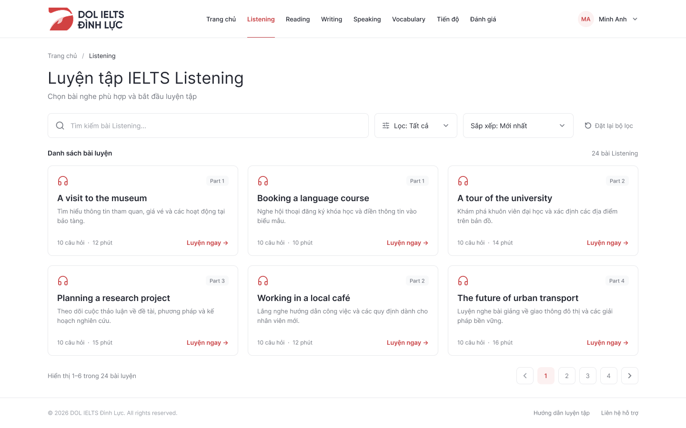

Hình 47. Giao diện xem danh sách bài luyện listening (minh họa 1)

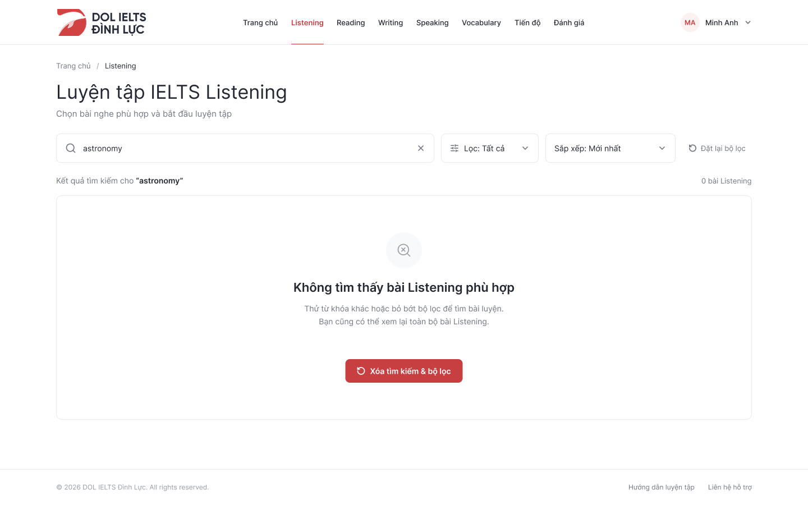

Hình 48. Giao diện xem danh sách bài luyện listening (minh họa 2)

**Đặc tả use case Làm bài Listening**

| Use case name | Làm bài Listening | UC-LIS-02 |
| --- | --- | --- |
| Description | Học viên thực hiện bài luyện Listening đã chọn bằng cách nghe audio và trả lời các câu hỏi của bài luyện | Học viên thực hiện bài luyện Listening đã chọn bằng cách nghe audio và trả lời các câu hỏi của bài luyện |
| Actor | Học viên | Priority: Cao |
| Trigger | Học viên chọn một bài Listening từ danh sách bài luyện. | Học viên chọn một bài Listening từ danh sách bài luyện. |
| Pre-Conditions | Học viên đã đăng nhập, tài khoản đang hoạt động, thuộc Group HOC_VIEN và bài Listening được chọn đang khả dụng | Học viên đã đăng nhập, tài khoản đang hoạt động, thuộc Group HOC_VIEN và bài Listening được chọn đang khả dụng |
| Post-Conditions | Các câu trả lời hiện tại chỉ được duy trì trên giao diện trong lúc làm bài để tiếp tục thực hiện hoặc nộp; chưa lưu vào lịch sử khi chưa nộp thành công. | Các câu trả lời hiện tại chỉ được duy trì trên giao diện trong lúc làm bài để tiếp tục thực hiện hoặc nộp; chưa lưu vào lịch sử khi chưa nộp thành công. |
| Basic Flow | Học viên | Hệ thống |
| Basic Flow | 1. Chọn một bài Listening | 2. Kiểm tra quyền Học viên và xác định bài Listening được chọn. |
| Basic Flow |  | 3. Truy xuất thông tin bài luyện, audio và danh sách câu hỏi. |
| Basic Flow |  | 4. Hiển thị giao diện làm bài Listening. |
| Basic Flow | 5. Phát audio và nghe nội dung bài. | 6. Phát audio tương ứng của bài luyện. |
|  | 7. Nhập hoặc lựa chọn câu trả lời cho các câu hỏi. | 8. Ghi nhận câu trả lời của học viên trong phiên làm bài. |
|  | 9. Tiếp tục làm câu hỏi hoặc chọn nộp dù vẫn còn câu chưa trả lời. |  |
|  | 10. Chọn “Nộp bài”. | 11. Chuyển sang chức năng “Nộp bài Listening”. |
| Alternative Flow | A1 - Điều khiển audio: Học viên phát lại, tạm dừng, tiếp tục hoặc điều chỉnh vị trí phát theo các thao tác đã có. A2 - Thay đổi hoặc xóa câu trả lời: Học viên chỉnh sửa; câu bị xóa trở thành chưa trả lời. A3 - Bỏ qua hoặc trả lời không theo thứ tự: Học viên có thể quay lại các câu còn trống. A4 - Audio kết thúc trước khi trả lời xong: Giao diện vẫn duy trì để trả lời hoặc nghe lại. A5 - Rời bài trước khi nộp: Học viên chọn rời bài khi chưa nộp (điều hướng trong website, quay lại, tải lại hoặc đóng tab). Với điều hướng do website kiểm soát, hệ thống hiển thị: “Bài làm chưa được lưu. Nếu thoát, bạn sẽ mất nội dung đã thực hiện. Bạn có chắc chắn muốn thoát?” Chọn ở lại: giữ nguyên nội dung hiện tại và tiếp tục làm bài. Xác nhận thoát: rời bài, không lưu bài chưa nộp vào lịch sử. Tải lại/đóng tab hoặc rời website sử dụng cảnh báo mặc định do trình duyệt hỗ trợ; không bảo đảm hiển thị nguyên văn thông báo tùy chỉnh hoặc xuất hiện trong mọi tình huống. | A1 - Điều khiển audio: Học viên phát lại, tạm dừng, tiếp tục hoặc điều chỉnh vị trí phát theo các thao tác đã có. A2 - Thay đổi hoặc xóa câu trả lời: Học viên chỉnh sửa; câu bị xóa trở thành chưa trả lời. A3 - Bỏ qua hoặc trả lời không theo thứ tự: Học viên có thể quay lại các câu còn trống. A4 - Audio kết thúc trước khi trả lời xong: Giao diện vẫn duy trì để trả lời hoặc nghe lại. A5 - Rời bài trước khi nộp: Học viên chọn rời bài khi chưa nộp (điều hướng trong website, quay lại, tải lại hoặc đóng tab). Với điều hướng do website kiểm soát, hệ thống hiển thị: “Bài làm chưa được lưu. Nếu thoát, bạn sẽ mất nội dung đã thực hiện. Bạn có chắc chắn muốn thoát?” Chọn ở lại: giữ nguyên nội dung hiện tại và tiếp tục làm bài. Xác nhận thoát: rời bài, không lưu bài chưa nộp vào lịch sử. Tải lại/đóng tab hoặc rời website sử dụng cảnh báo mặc định do trình duyệt hỗ trợ; không bảo đảm hiển thị nguyên văn thông báo tùy chỉnh hoặc xuất hiện trong mọi tình huống. |
| Exception Flow | E1 - Bài Listening không tồn tại hoặc đã bị ẩn → hệ thống thông báo bài luyện không còn khả dụng và đưa học viên về danh sách bài luyện.  E2 - Không thể tải audio hoặc nội dung câu hỏi → hệ thống thông báo không thể tải bài luyện và cho phép học viên thử lại.  E3 - Tài khoản không còn quyền sử dụng → hệ thống không cho phép bắt đầu bài luyện và hiển thị thông báo phù hợp.  Nếu phiên đăng nhập không hợp lệ, tài khoản bị khóa hoặc không còn thuộc Group HOC_VIEN, hệ thống từ chối thao tác; yêu cầu đăng nhập hoặc thông báo cần quản trị viên cấp quyền Học viên. | E1 - Bài Listening không tồn tại hoặc đã bị ẩn → hệ thống thông báo bài luyện không còn khả dụng và đưa học viên về danh sách bài luyện.  E2 - Không thể tải audio hoặc nội dung câu hỏi → hệ thống thông báo không thể tải bài luyện và cho phép học viên thử lại.  E3 - Tài khoản không còn quyền sử dụng → hệ thống không cho phép bắt đầu bài luyện và hiển thị thông báo phù hợp.  Nếu phiên đăng nhập không hợp lệ, tài khoản bị khóa hoặc không còn thuộc Group HOC_VIEN, hệ thống từ chối thao tác; yêu cầu đăng nhập hoặc thông báo cần quản trị viên cấp quyền Học viên. |

Bảng 31. Đặc tả use case Làm bài Listening

**Thiết kế giao diện:**

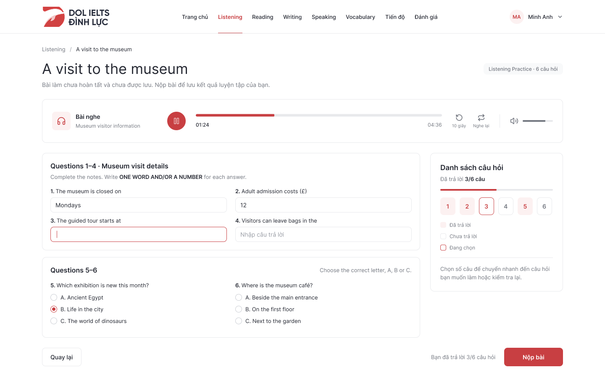

Hình 49. Giao diện làm bài Listening

**Đặc tả use case Nộp bài Listening**

| Use case name | Nộp bài Listening | UC-LIS-03 |
| --- | --- | --- |
| Description | Học viên gửi bài Listening đã thực hiện. Hệ thống tiếp nhận câu trả lời, thực hiện chấm điểm và lưu kết quả của lượt luyện tập | Học viên gửi bài Listening đã thực hiện. Hệ thống tiếp nhận câu trả lời, thực hiện chấm điểm và lưu kết quả của lượt luyện tập |
| Actor | Học viên | Priority: Cao |
| Trigger | Học viên chọn nút “Nộp bài” trong quá trình làm bài Listening | Học viên chọn nút “Nộp bài” trong quá trình làm bài Listening |
| Pre-Conditions | Học viên đã đăng nhập, tài khoản đang hoạt động, thuộc Group HOC_VIEN và bài Listening được chọn đang khả dụng | Học viên đã đăng nhập, tài khoản đang hoạt động, thuộc Group HOC_VIEN và bài Listening được chọn đang khả dụng |
| Post-Conditions | Chỉ khi nộp hợp lệ và lưu thành công, hệ thống ghi một lượt luyện Listening cùng bài làm, điểm và thời gian; giữ nguyên lượt cũ. Gửi lặp cùng một yêu cầu không tạo thêm lượt; chỉ hành động luyện lại chủ động mới tạo lượt mới. | Chỉ khi nộp hợp lệ và lưu thành công, hệ thống ghi một lượt luyện Listening cùng bài làm, điểm và thời gian; giữ nguyên lượt cũ. Gửi lặp cùng một yêu cầu không tạo thêm lượt; chỉ hành động luyện lại chủ động mới tạo lượt mới. |
| Basic Flow | Học viên | Hệ thống |
| Basic Flow | 1. Đang thực hiện bài Listening; có thể chưa trả lời hết hoặc bỏ trống toàn bộ. |  |
| Basic Flow | 2. Chọn “Nộp bài” | 3. Kiểm tra lại phiên đăng nhập, quyền Học viên, bài luyện và dữ liệu bài làm. |
| Basic Flow |  | 4. Kiểm tra các câu chưa trả lời; nếu còn câu trống, hiển thị cảnh báo và cho chọn Làm tiếp hoặc Vẫn nộp; nếu đủ câu, hiển thị xác nhận nộp thông thường. |
| Basic Flow | 5. Xác nhận nộp bài. | 6. Gọi use case UC-LIS-04 - Chấm điểm bài Listening. |
|  |  | 7. Nhận kết quả chấm điểm. |
|  |  | 8. Lưu lượt luyện, bài làm và kết quả theo tài khoản học viên. |
|  |  | 9. Hiển thị thông báo “Nộp bài thành công”. |
|  | 10. Chọn xem kết quả bài làm. | 11. Điều hướng đến chức năng “Xem kết quả bài làm”. |
| Alternative Flow | A1 - Hủy xác nhận hoặc chọn Làm tiếp: Giữ nguyên câu trả lời hiện tại, chưa lưu lịch sử. A2 - Còn câu chưa trả lời: Học viên có thể xác nhận vẫn nộp; các câu trống không được tính là đúng. A3 - Bỏ trống toàn bộ: Được phép xác nhận nộp sau cảnh báo; nếu chấm và lưu thành công thì kết quả 0 câu đúng. A4 - Luyện lại một cách chủ động: Tạo lượt luyện mới, không ghi đè lịch sử trước đó. | A1 - Hủy xác nhận hoặc chọn Làm tiếp: Giữ nguyên câu trả lời hiện tại, chưa lưu lịch sử. A2 - Còn câu chưa trả lời: Học viên có thể xác nhận vẫn nộp; các câu trống không được tính là đúng. A3 - Bỏ trống toàn bộ: Được phép xác nhận nộp sau cảnh báo; nếu chấm và lưu thành công thì kết quả 0 câu đúng. A4 - Luyện lại một cách chủ động: Tạo lượt luyện mới, không ghi đè lịch sử trước đó. |
| Exception Flow | E1 - Phiên đăng nhập hết hạn, mất HOC_VIEN, tài khoản khóa, bài ẩn hoặc dữ liệu nộp không hợp lệ: Từ chối nộp và thông báo phù hợp; bỏ trống câu hỏi không phải dữ liệu không hợp lệ. E2 - Không thể chấm: Báo lỗi và không tạo lượt luyện hoàn tất. E3 - Lưu thất bại: Báo lỗi, không ghi nhận lượt luyện chưa hoàn tất. E4 - Gửi trùng cùng một yêu cầu nộp đã thành công: Không tạo thêm lượt luyện. | E1 - Phiên đăng nhập hết hạn, mất HOC_VIEN, tài khoản khóa, bài ẩn hoặc dữ liệu nộp không hợp lệ: Từ chối nộp và thông báo phù hợp; bỏ trống câu hỏi không phải dữ liệu không hợp lệ. E2 - Không thể chấm: Báo lỗi và không tạo lượt luyện hoàn tất. E3 - Lưu thất bại: Báo lỗi, không ghi nhận lượt luyện chưa hoàn tất. E4 - Gửi trùng cùng một yêu cầu nộp đã thành công: Không tạo thêm lượt luyện. |

Bảng 32. Đặc tả use case Nộp bài Listening

**Thiết kế giao diện:**

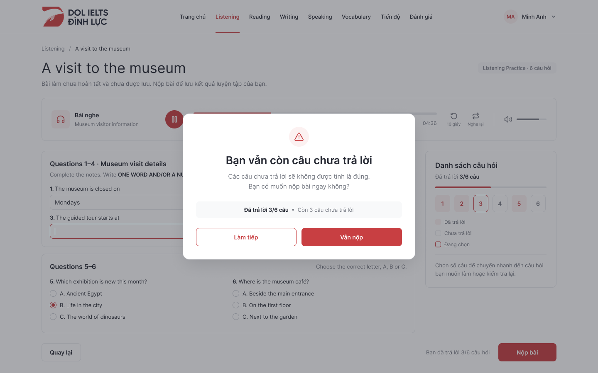

Hình 50. Giao diện nộp bài Listening (minh họa 1)

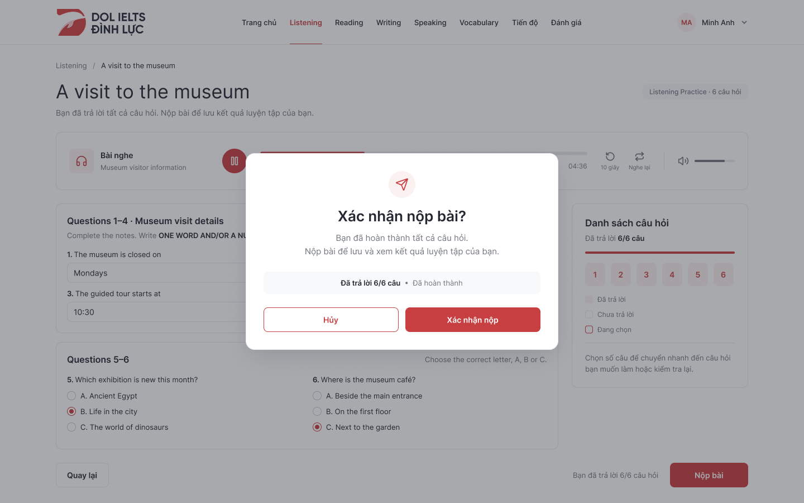

Hình 51. Giao diện nộp bài Listening (minh họa 2)

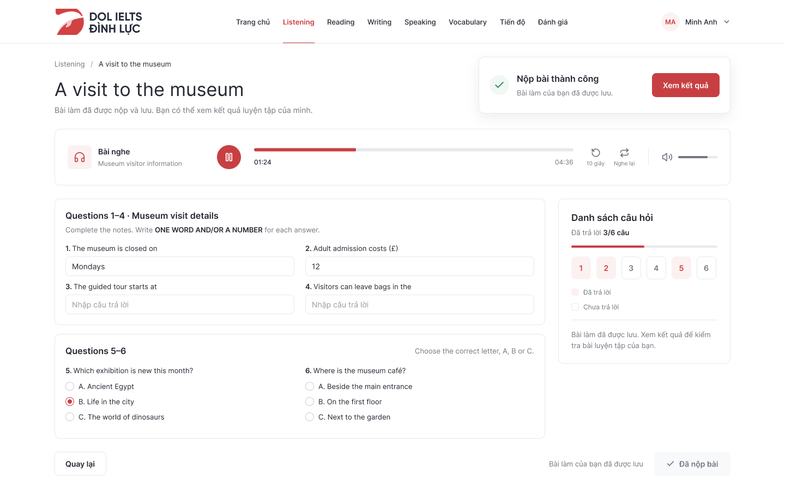

Hình 52. Giao diện nộp bài Listening (minh họa 3)

**Đặc tả use case Chấm điểm bài Listening**

| Use case name | Chấm điểm bài Listening | UC-LIS-04 |
| --- | --- | --- |
| Description | Hệ thống đối chiếu câu trả lời của học viên với đáp án của bài Listening và tính kết quả bài làm. Use case này được thực hiện khi học viên nộp bài Listening | Hệ thống đối chiếu câu trả lời của học viên với đáp án của bài Listening và tính kết quả bài làm. Use case này được thực hiện khi học viên nộp bài Listening |
| Actor | Học viên | Priority: Cao |
| Trigger | Use case “Nộp bài Listening” yêu cầu hệ thống chấm điểm bài làm | Use case “Nộp bài Listening” yêu cầu hệ thống chấm điểm bài làm |
| Pre-Conditions | Bài làm Listening hợp lệ đã được gửi; bài luyện có đáp án để hệ thống đối chiếu. Yêu cầu nộp bài đã được kiểm tra: tài khoản đang hoạt động, đã đăng nhập và thuộc Group HOC_VIEN; câu trả lời thuộc đúng bài đang nộp. | Bài làm Listening hợp lệ đã được gửi; bài luyện có đáp án để hệ thống đối chiếu. Yêu cầu nộp bài đã được kiểm tra: tài khoản đang hoạt động, đã đăng nhập và thuộc Group HOC_VIEN; câu trả lời thuộc đúng bài đang nộp. |
| Post-Conditions | Kết quả chấm điểm của bài Listening được xác định và trả về cho quá trình nộp bài | Kết quả chấm điểm của bài Listening được xác định và trả về cho quá trình nộp bài |
| Basic Flow | Học viên | Hệ thống |
| Basic Flow | 1. Xác nhận nộp bài Listening. | 2. Nhận dữ liệu câu trả lời của bài làm |
| Basic Flow |  | 3. Truy xuất đáp án của bài Listening. |
| Basic Flow |  | 4. Đối chiếu từng câu trả lời của học viên với đáp án đúng. |
| Basic Flow |  | 5. Xác định số câu đúng và số câu sai. |
|  |  | 6. Tính kết quả bài Listening. |
|  |  | 7. Trả kết quả chấm điểm cho use case “Nộp bài Listening”. |
| Alternative Flow | A1 - Còn câu bỏ trống: Ghi nhận là chưa trả lời, không tính đúng; chấm những câu còn lại. A2 - Bỏ trống toàn bộ: Chấm hợp lệ với kết quả 0 câu đúng rồi trả về UC-LIS-03 để lưu khi nộp thành công. | A1 - Còn câu bỏ trống: Ghi nhận là chưa trả lời, không tính đúng; chấm những câu còn lại. A2 - Bỏ trống toàn bộ: Chấm hợp lệ với kết quả 0 câu đúng rồi trả về UC-LIS-03 để lưu khi nộp thành công. |
| Exception Flow | E1 - Không tìm thấy đáp án của bài Listening → hệ thống không thể hoàn tất chấm điểm và ghi nhận lỗi xử lý. E2 - Dữ liệu bài làm không hợp lệ → hệ thống dừng quá trình chấm. | E1 - Không tìm thấy đáp án của bài Listening → hệ thống không thể hoàn tất chấm điểm và ghi nhận lỗi xử lý. E2 - Dữ liệu bài làm không hợp lệ → hệ thống dừng quá trình chấm. |

Bảng 33. Đặc tả use case Chấm điểm bài Listening

**Thiết kế giao diện:**

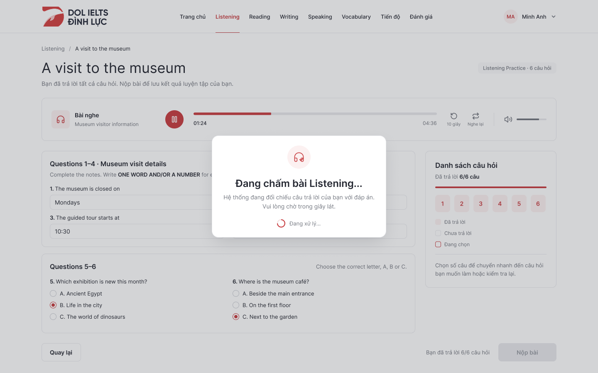

Hình 53. Giao diện chấm điểm bài Listening

**Đặc tả use case Xem kết quả bài làm**

| Use case name | Xem kết quả bài làm | UC-LIS-05 |
| --- | --- | --- |
| Description | Học viên xem kết quả của bài Listening đã hoàn thành, bao gồm kết quả tổng quát và chi tiết câu trả lời của bài làm. | Học viên xem kết quả của bài Listening đã hoàn thành, bao gồm kết quả tổng quát và chi tiết câu trả lời của bài làm. |
| Actor | Học viên | Priority: Cao |
| Trigger | Học viên chọn “Xem kết quả” sau khi nộp bài Listening. | Học viên chọn “Xem kết quả” sau khi nộp bài Listening. |
| Pre-Conditions | Học viên đã đăng nhập, tài khoản đang hoạt động, thuộc Group HOC_VIEN và bài Listening được chọn đang khả dụng | Học viên đã đăng nhập, tài khoản đang hoạt động, thuộc Group HOC_VIEN và bài Listening được chọn đang khả dụng |
| Post-Conditions | Kết quả bài Listening được hiển thị. Không làm thay đổi dữ liệu bài làm. | Kết quả bài Listening được hiển thị. Không làm thay đổi dữ liệu bài làm. |
| Basic Flow | Học viên | Hệ thống |
| Basic Flow | 1. Chọn “Xem kết quả”. | 2. Xác định lượt luyện Listening tương ứng. |
| Basic Flow |  | 3. Truy xuất kết quả và các câu trả lời đã lưu. |
| Basic Flow |  | 4. Hiển thị kết quả bài Listening. |
| Basic Flow | 5. Xem kết quả bài làm. |  |
|  | 6. Chọn xem chi tiết đáp án. | 7. Hiển thị từng câu hỏi, câu trả lời của học viên và đáp án đúng. |
| Alternative Flow | A1 - Xem đáp án chi tiết: Học viên chọn “Xem đáp án” → hệ thống hiển thị câu trả lời của học viên và đáp án đúng của từng câu. A2 - Luyện lại: Học viên chọn “Luyện lại” → hệ thống bắt đầu một lượt luyện mới với bài Listening tương ứng. A3 - Quay lại danh sách: Học viên chọn quay lại → hệ thống hiển thị danh sách các bài luyện Listening. | A1 - Xem đáp án chi tiết: Học viên chọn “Xem đáp án” → hệ thống hiển thị câu trả lời của học viên và đáp án đúng của từng câu. A2 - Luyện lại: Học viên chọn “Luyện lại” → hệ thống bắt đầu một lượt luyện mới với bài Listening tương ứng. A3 - Quay lại danh sách: Học viên chọn quay lại → hệ thống hiển thị danh sách các bài luyện Listening. |
| Exception Flow | E1 - Không tìm thấy kết quả bài làm → hệ thống hiển thị “Không tìm thấy kết quả bài Listening”.  E2 - Lượt luyện không thuộc tài khoản học viên → hệ thống từ chối truy cập.  E3 - Không thể truy xuất dữ liệu kết quả → hệ thống thông báo lỗi và cho phép học viên thử lại.  Nếu phiên đăng nhập không hợp lệ, tài khoản bị khóa hoặc không còn thuộc Group HOC_VIEN, hệ thống từ chối thao tác; yêu cầu đăng nhập hoặc thông báo cần quản trị viên cấp quyền Học viên. | E1 - Không tìm thấy kết quả bài làm → hệ thống hiển thị “Không tìm thấy kết quả bài Listening”.  E2 - Lượt luyện không thuộc tài khoản học viên → hệ thống từ chối truy cập.  E3 - Không thể truy xuất dữ liệu kết quả → hệ thống thông báo lỗi và cho phép học viên thử lại.  Nếu phiên đăng nhập không hợp lệ, tài khoản bị khóa hoặc không còn thuộc Group HOC_VIEN, hệ thống từ chối thao tác; yêu cầu đăng nhập hoặc thông báo cần quản trị viên cấp quyền Học viên. |

Bảng 34. Đặc tả use case Xem kết quả bài làm

**Thiết kế giao diện:**

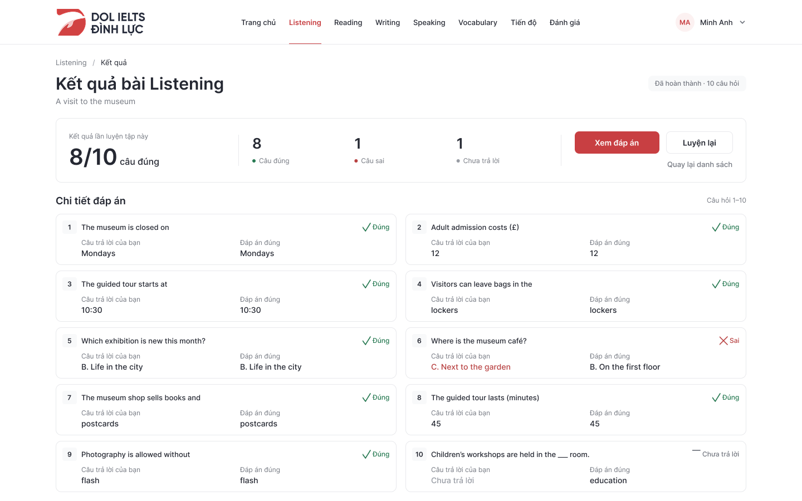

Hình 54. Giao diện xem kết quả bài làm (minh họa 2)

**Đặc tả use case Quản lý bài Listening**

| Use case name | Quản lý bài Listening | UC-LIS-06 |
| --- | --- | --- |
| Description | Quản trị viên xem và quản lý các bài luyện Listening trong hệ thống, bao gồm thêm mới, sửa và ẩn hoặc xóa bài Listening | Quản trị viên xem và quản lý các bài luyện Listening trong hệ thống, bao gồm thêm mới, sửa và ẩn hoặc xóa bài Listening |
| Actor | Quản trị viên | Priority: Cao |
| Trigger | Quản trị viên chọn chức năng “Quản lý bài Listening”. | Quản trị viên chọn chức năng “Quản lý bài Listening”. |
| Pre-Conditions | Quản trị viên đã đăng nhập và có quyền quản lý nội dung Listening. | Quản trị viên đã đăng nhập và có quyền quản lý nội dung Listening. |
| Post-Conditions | Danh sách bài Listening được hiển thị hoặc dữ liệu bài Listening được cập nhật theo thao tác của Quản trị viên. | Danh sách bài Listening được hiển thị hoặc dữ liệu bài Listening được cập nhật theo thao tác của Quản trị viên. |
| Basic Flow | Quản trị viên | Hệ thống |
| Basic Flow | 1. Chọn chức năng “Quản lý bài Listening”. | 2. Kiểm tra quyền truy cập của Quản trị viên. |
| Basic Flow |  | 3.Truy xuất danh sách các bài Listening hiện có. |
| Basic Flow |  | 4. Hiển thị danh sách và trạng thái của từng bài Listening. |
| Basic Flow | 5. Xem danh sách các bài Listening. |  |
| Alternative Flow | A1 - Thêm bài Listening: Quản trị viên chọn “Thêm bài Listening” → hệ thống hiển thị biểu mẫu → Quản trị viên nhập thông tin bài luyện, audio, câu hỏi và đáp án → chọn trạng thái → nhấn “Lưu” → hệ thống kiểm tra và tạo bài mới.  A2 - Sửa bài Listening: Quản trị viên chọn “Sửa” tại một bài → hệ thống hiển thị dữ liệu hiện tại → Quản trị viên chỉnh sửa → nhấn “Lưu” → hệ thống cập nhật bài Listening.  A3 - Ẩn bài Listening: Quản trị viên chọn “Ẩn” → hệ thống yêu cầu xác nhận → cập nhật trạng thái bài → bài không còn xuất hiện trong danh sách luyện tập của học viên.  A4 - Xóa bài Listening: Quản trị viên chọn “Xóa” → hệ thống yêu cầu xác nhận → Nếu bài Listening đã phát sinh lịch sử luyện tập thì không xóa vật lý; Quản trị viên chỉ được Ẩn bài để bảo toàn dữ liệu các lượt luyện trước. A5 - Hiện lại bài Listening: Quản trị viên chọn “Hiện” đối với bài đang bị ẩn → hệ thống cập nhật trạng thái → bài được phép xuất hiện trở lại cho học viên. | A1 - Thêm bài Listening: Quản trị viên chọn “Thêm bài Listening” → hệ thống hiển thị biểu mẫu → Quản trị viên nhập thông tin bài luyện, audio, câu hỏi và đáp án → chọn trạng thái → nhấn “Lưu” → hệ thống kiểm tra và tạo bài mới.  A2 - Sửa bài Listening: Quản trị viên chọn “Sửa” tại một bài → hệ thống hiển thị dữ liệu hiện tại → Quản trị viên chỉnh sửa → nhấn “Lưu” → hệ thống cập nhật bài Listening.  A3 - Ẩn bài Listening: Quản trị viên chọn “Ẩn” → hệ thống yêu cầu xác nhận → cập nhật trạng thái bài → bài không còn xuất hiện trong danh sách luyện tập của học viên.  A4 - Xóa bài Listening: Quản trị viên chọn “Xóa” → hệ thống yêu cầu xác nhận → Nếu bài Listening đã phát sinh lịch sử luyện tập thì không xóa vật lý; Quản trị viên chỉ được Ẩn bài để bảo toàn dữ liệu các lượt luyện trước. A5 - Hiện lại bài Listening: Quản trị viên chọn “Hiện” đối với bài đang bị ẩn → hệ thống cập nhật trạng thái → bài được phép xuất hiện trở lại cho học viên. |
| Exception Flow | E1 - Thiếu thông tin bắt buộc → hệ thống yêu cầu Quản trị viên bổ sung trước khi lưu.  E2 - Dữ liệu bài Listening không hợp lệ → hệ thống hiển thị lỗi tại trường tương ứng.  E3 - Không tìm thấy bài cần sửa, ẩn hoặc xóa → hệ thống thông báo bài Listening không tồn tại.  E4 - Quá trình lưu hoặc cập nhật thất bại → hệ thống thông báo lỗi và không ghi nhận thay đổi chưa hoàn tất. | E1 - Thiếu thông tin bắt buộc → hệ thống yêu cầu Quản trị viên bổ sung trước khi lưu.  E2 - Dữ liệu bài Listening không hợp lệ → hệ thống hiển thị lỗi tại trường tương ứng.  E3 - Không tìm thấy bài cần sửa, ẩn hoặc xóa → hệ thống thông báo bài Listening không tồn tại.  E4 - Quá trình lưu hoặc cập nhật thất bại → hệ thống thông báo lỗi và không ghi nhận thay đổi chưa hoàn tất. |

Bảng 35. Đặc tả use case Quản lý bài Listening

**Thiết kế giao diện:**

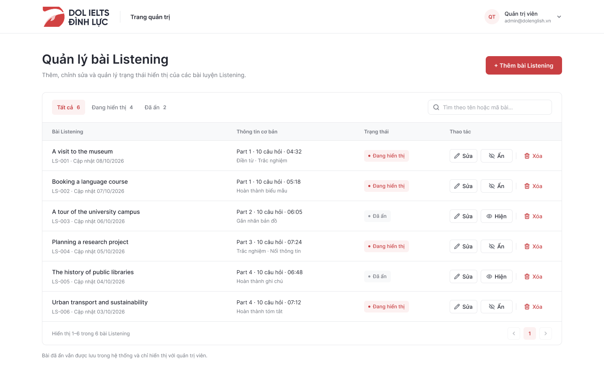

Hình 55. Giao diện quản lý bài Listening (minh họa 1)

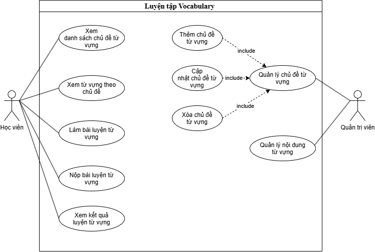

Hình 56. Giao diện quản lý bài Listening (minh họa 2)

## E. Thiết kế CSDL liên quan Reading và Listening

PHẦN 3: CƠ SỞ DỮ LIỆU VÀ XÂY DỰNG GIAO DIỆN

I. Thiết kế cơ sở dữ liệu

#### 1.1. Mục tiêu thiết kế cơ sở dữ liệu

Việc thiết kế cơ sở dữ liệu nhằm đáp ứng các chức năng đã xác định trong Phần 2, bao gồm quản lý tài khoản và quyền Học viên; tổ chức luyện tập Listening, Reading, Writing, Speaking và Vocabulary; lưu lại bài làm, kết quả qua nhiều lần luyện; theo dõi tiến độ học tập và tiếp nhận đánh giá, góp ý của người dùng. Hệ thống không xây dựng riêng các chức năng IELTS Online Test, Dictation hoặc kho bài mẫu độc lập.

Hệ thống sử dụng cơ sở dữ liệu quan hệ PostgreSQL kết hợp với Django ORM để quản lý và truy xuất dữ liệu. Các bảng được liên kết bằng khóa chính và khóa ngoại nhằm bảo đảm tính nhất quán. Quyền Học viên được quản lý thông qua nhóm HOC_VIEN của Django; mỗi lần nộp bài được lưu thành một bản ghi riêng để giữ lại lịch sử luyện tập. Kết quả chấm Writing và Speaking được lưu cùng bài nộp, còn dữ liệu theo dõi tiến độ (Progress) được tổng hợp từ lịch sử, không thiết kế thành bảng độc lập.

#### 1.2. Cơ sở dữ liệu

Cơ sở dữ liệu gồm 19 bảng, trong đó có 3 bảng tài khoản và nhóm quyền sẵn có của Django cùng 16 bảng phục vụ nghiệp vụ của hệ thống. Các bảng được tổ chức thành các nhóm chức năng; tên bảng, thuộc tính và kiểu dữ liệu được trình bày chi tiết tại mục 1.3. Hai nhóm bảng Reading và Listening được tích hợp thành năm bảng dùng chung, có trường skill để phân biệt kỹ năng và vẫn phục vụ hai chức năng luyện tập riêng biệt.

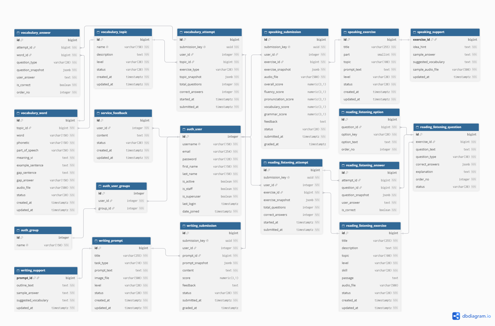

Hình 82. Sơ đồ quan hệ cơ sở dữ liệu

Link DRD

Toàn bộ cơ sở dữ liệu được chia thành 6 nhóm bảng chức năng chính:

•  Nhóm quản lý tài khoản và quyền Học viên

•  Nhóm luyện tập Reading và Listening

•  Nhóm luyện tập Writing

•  Nhóm luyện tập Speaking

•  Nhóm luyện tập Vocabulary

•  Nhóm đánh giá và góp ý

Các bảng dữ liệu liên kết với nhau theo hoạt động của từng chức năng. Một tài khoản người dùng có thể thuộc nhiều nhóm quyền thông qua bảng auth_user_groups. Khi được cấp quyền Học viên, người dùng có thể thực hiện nhiều lượt luyện Listening, Reading, Writing, Speaking và Vocabulary, đồng thời gửi nhiều đánh giá, góp ý. Mỗi lượt luyện hoặc bài nộp đều gắn với tài khoản đã thực hiện.

Mỗi bài luyện Reading và Listening được lưu tại bảng reading_listening_exercise và phân biệt qua skill (READING hoặc LISTENING). Trường passage lưu nội dung Reading, trường audio_file lưu đường dẫn âm thanh Listening; hai trường được phép NULL vì không áp dụng đồng thời cho cả hai kỹ năng. Trước khi công bố, hệ thống kiểm tra bài Reading có passage và bài Listening có audio_file. Mỗi bài luyện gồm nhiều câu hỏi; tùy theo dạng câu hỏi, một câu có thể có nhiều phương án lựa chọn. Khi Học viên nộp bài, hệ thống lưu một lượt luyện cùng các câu trả lời tương ứng để phục vụ chấm điểm và xem lại kết quả.

Đối với Writing và Speaking, mỗi đề có tối đa một bản nội dung hỗ trợ. Một đề có thể được nhiều Học viên lựa chọn và mỗi Học viên có thể nộp nhiều lần. Ở chức năng Vocabulary, một chủ đề có nhiều từ vựng và có thể được luyện tập nhiều lần; mỗi lượt luyện lưu các đơn vị trả lời của lần thực hiện đó.

Về quản lý quyền truy cập, việc đăng ký tài khoản không đồng nghĩa với được cấp quyền Học viên. Quyền HOC_VIEN do Quản trị viên cấp hoặc thu hồi thông qua nhóm quyền của Django. Thiết kế cũng không bổ sung trường dữ liệu hay cơ chế học thử. Những bài luyện, câu hỏi hoặc từ vựng đã có lịch sử sử dụng được chuyển sang trạng thái ẩn thay vì xóa khỏi cơ sở dữ liệu, nhằm giữ nguyên dữ liệu của các lần luyện trước.

Đối với Writing và Speaking, hệ thống lưu bài nộp trước khi gửi yêu cầu chấm điểm đến dịch vụ AI. Trạng thái xử lý gồm GRADING (đang chấm), GRADED (đã chấm) và FAILED (chấm không thành công). Khi chưa nhận được kết quả hợp lệ, trường điểm được để NULL, không tự động gán bằng 0. Điểm số và nhận xét của AI được lưu trực tiếp trong bản ghi bài nộp, không tạo bảng riêng để lưu kết quả chấm.

Tiến độ học tập (Progress) được tổng hợp từ bảng reading_listening_attempt, writing_submission, speaking_submission và vocabulary_attempt theo tài khoản và thời điểm nộp (submitted_at). Dữ liệu Reading và Listening được phân loại thông qua reading_listening_attempt.exercise_id → reading_listening_exercise.skill; hai kỹ năng vẫn có thống kê riêng. Với Reading, Listening và Vocabulary, tỷ lệ đúng được tính từ số câu đúng và tổng số câu; với Writing và Speaking, hệ thống sử dụng điểm AI hợp lệ. Các bài Writing/Speaking ở trạng thái GRADING hoặc FAILED vẫn được tính là lượt đã nộp nhưng không đưa vào thống kê điểm. Không tạo bảng Progress độc lập.

Hệ thống dự kiến sử dụng PostgreSQL kết hợp Django ORM và lưu trữ cơ sở dữ liệu trực tuyến trên nền tảng Neon (có thể có sự lựa chọn khác sau này), tùy theo điều kiện triển khai thực tế.

#### 1.3. Mô tả cơ sở dữ liệu

Cột Null cho biết trường dữ liệu có được phép nhận giá trị NULL hay không: No tương ứng với NOT NULL, Yes cho phép NULL. Các trường văn bản không bắt buộc có thể lưu chuỗi rỗng. Theo thiết kế hiện tại, khóa chính của các bảng nghiệp vụ sử dụng BIGINT, khóa ngoại tham chiếu đến User mặc định của Django sử dụng INTEGER; dữ liệu thời gian sử dụng TIMESTAMPTZ. Các trường tệp chỉ lưu đường dẫn hoặc thông tin tham chiếu đến tệp, không lưu trực tiếp nội dung tệp trong bảng.

#### B1: auth_user: Tài khoản người dùng.

| STT | Tên trường | Kiểu | Null | Diễn giải |
| --- | --- | --- | --- | --- |
| 1 | id | INTEGER | No | Khóa chính của User mặc định Django. |
| 2 | username | VARCHAR(150) | No | Tên đăng nhập, duy nhất. |
| 3 | email | VARCHAR(254) | No | Email liên hệ; bắt buộc trên form đăng ký. |
| 4 | password | VARCHAR(128) | No | Giá trị mật khẩu do Django băm. |
| 5 | first_name | VARCHAR(150) | No | Tên; có thể để trống. |
| 6 | last_name | VARCHAR(150) | No | Họ; có thể để trống. |
| 7 | is_active | BOOLEAN | No | TRUE: hoạt động; FALSE: khóa tài khoản. |
| 8 | is_staff | BOOLEAN | No | Cho phép vào khu vực Django Admin. |
| 9 | is_superuser | BOOLEAN | No | Quyền quản trị cao nhất. |
| 10 | last_login | TIMESTAMPTZ | Yes | Lần đăng nhập gần nhất. |
| 11 | date_joined | TIMESTAMPTZ | No | Thời điểm tạo tài khoản. |

Bảng 53. Tài khoản người dùng

#### B2: auth_group: Nhóm quyền của Django.

| STT | Tên trường | Kiểu | Null | Diễn giải |
| --- | --- | --- | --- | --- |
| 1 | id | INTEGER | No | Khóa chính của Group. |
| 2 | name | VARCHAR(150) | No | Tên nhóm, duy nhất; có nhóm HOC_VIEN. |

Bảng 54. Nhóm quyền của Django

#### B3: auth_user_groups: Liên kết tài khoản với nhóm quyền.

| STT | Tên trường | Kiểu | Null | Diễn giải |
| --- | --- | --- | --- | --- |
| 1 | id | INTEGER | No | Khóa chính tự tăng do Django tạo. |
| 2 | user_id | INTEGER | No | FK → auth_user.id. |
| 3 | group_id | INTEGER | No | FK → auth_group.id. |

Bảng 55. Liên kết tài khoản với nhóm quyền

#### B4: reading_listening_exercise: Bài luyện Reading và Listening.

| STT | Tên trường | Kiểu | Null | Diễn giải |
| --- | --- | --- | --- | --- |
| 1 | id | BIGINT | No | Khóa chính tự tăng. |
| 2 | title | VARCHAR(255) | No | Tên bài luyện. |
| 3 | description | TEXT | No | Mô tả ngắn; có thể để trống. |
| 4 | topic | VARCHAR(100) | No | Chủ đề để lọc bài. |
| 5 | level | VARCHAR(20) | No | BEGINNER, INTERMEDIATE hoặc ADVANCED. |
| 6 | skill | VARCHAR(20) | No | READING hoặc LISTENING; dùng để phân loại bài luyện. |
| 7 | passage | TEXT | Yes | Nội dung passage đối với Reading; NULL đối với Listening. |
| 8 | audio_file | VARCHAR(500) | Yes | Đường dẫn audio đối với Listening; NULL đối với Reading. |
| 9 | status | VARCHAR(20) | No | PUBLISHED (hiển thị) hoặc HIDDEN (ẩn); mặc định HIDDEN. Khi công bố, Reading phải có passage, Listening phải có audio_file. |
| 10 | created_at | TIMESTAMPTZ | No | Thời điểm tạo. |
| 11 | updated_at | TIMESTAMPTZ | No | Thời điểm cập nhật gần nhất. |

Bảng 56. Bài luyện Reading và Listening

#### B5: reading_listening_question: Câu hỏi Reading và Listening.

| STT | Tên trường | Kiểu | Null | Diễn giải |
| --- | --- | --- | --- | --- |
| 1 | id | BIGINT | No | Khóa chính tự tăng. |
| 2 | exercise_id | BIGINT | No | FK → reading_listening_exercise.id. |
| 3 | question_text | TEXT | No | Nội dung một mục chấm. |
| 4 | question_type | VARCHAR(30) | No | Loại câu hỏi: MCQ, SHORT_TEXT, MATCHING, TFNG hoặc YNNG; kiểm tra phù hợp theo skill. |
| 5 | correct_answers | JSONB | No | Danh sách đáp án được chấp nhận của mục chấm. |
| 6 | explanation | TEXT | No | Giải thích đáp án; có thể để trống. |
| 7 | order_no | INTEGER | No | Thứ tự trong bài, từ 1. |
| 8 | status | VARCHAR(20) | No | PUBLISHED hoặc HIDDEN; câu đã có lịch sử chỉ được ẩn. |

Bảng 57. Câu hỏi Reading và Listening

#### B6: reading_listening_option: Phương án câu hỏi Reading và Listening.

| STT | Tên trường | Kiểu | Null | Diễn giải |
| --- | --- | --- | --- | --- |
| 1 | id | BIGINT | No | Khóa chính tự tăng. |
| 2 | question_id | BIGINT | No | FK → reading_listening_question.id. |
| 3 | option_key | VARCHAR(20) | No | Mã phương án trong câu hỏi, ví dụ A, B, C. |
| 4 | option_text | TEXT | No | Nội dung phương án. |
| 5 | order_no | INTEGER | No | Thứ tự hiển thị, từ 1. |

Bảng 58. Phương án câu hỏi Reading và Listening

#### B7: reading_listening_attempt: Lượt luyện Reading và Listening.

| STT | Tên trường | Kiểu | Null | Diễn giải |
| --- | --- | --- | --- | --- |
| 1 | id | BIGINT | No | Khóa chính tự tăng. |
| 2 | submission_key | UUID | No | Mã nộp do máy chủ sinh, duy nhất; chống gửi lặp. |
| 3 | user_id | INTEGER | No | FK → auth_user.id. |
| 4 | exercise_id | BIGINT | No | FK → reading_listening_exercise.id. |
| 5 | exercise_snapshot | JSONB | No | Bản chụp tên, kỹ năng và nội dung bài khi bắt đầu. |
| 6 | total_questions | INTEGER | No | Tổng số mục chấm của lượt luyện; lớn hơn 0. |
| 7 | correct_answers | INTEGER | No | Số mục trả lời đúng, từ 0 đến total_questions. |
| 8 | started_at | TIMESTAMPTZ | No | Thời điểm bắt đầu do máy chủ ghi nhận. |
| 9 | submitted_at | TIMESTAMPTZ | No | Thời điểm nộp hợp lệ. |

Bảng 59. Lượt luyện Reading và Listening

#### B8: reading_listening_answer: Câu trả lời Reading và Listening.

| STT | Tên trường | Kiểu | Null | Diễn giải |
| --- | --- | --- | --- | --- |
| 1 | id | BIGINT | No | Khóa chính tự tăng. |
| 2 | attempt_id | BIGINT | No | FK → reading_listening_attempt.id. |
| 3 | question_id | BIGINT | No | FK → reading_listening_question.id; câu hỏi phải thuộc bài của lượt luyện. |
| 4 | question_snapshot | JSONB | No | Bản chụp câu hỏi, loại, thứ tự, phương án, đáp án và giải thích. |
| 5 | user_answer | TEXT | No | Câu trả lời đã nộp; bỏ trống lưu chuỗi rỗng. |
| 6 | is_correct | BOOLEAN | No | Kết quả đối chiếu tại thời điểm nộp. |

Bảng 60. Câu trả lời Reading và Listening
